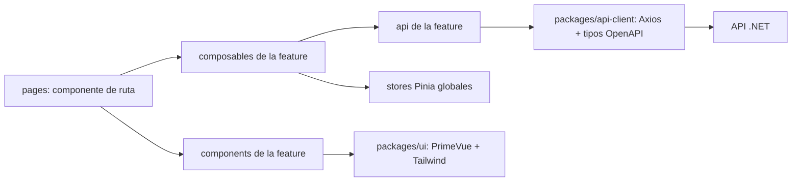

# Arquitectura Frontend — Sistema de Préstamos (Fintech 100% Digital)

Arquitectura de las dos aplicaciones web del sistema sobre **Vue 3**. Implementa los requerimientos de [`docs/REQUERIMIENTOS_FRONTEND.md`](docs/REQUERIMIENTOS_FRONTEND.md) (IDs `FE-BO`, `FE-CP` y `FE-NF`) y respeta las decisiones de [`ARQUITECTURA_GENERAL.md`](ARQUITECTURA_GENERAL.md):
- Dos SPAs separadas (ADR 08).
- Contrato OpenAPI como fuente única de tipos.
- El frontend **nunca calcula dinero**.

| Aplicación | Usuarios | Prioridad de diseño |
|---|---|---|
| **Backoffice** (`apps/backoffice`) | Analistas, operadores, tesorería, cobranza, auditoría, administración | Productividad: tablas densas, filtros, atajos, escritorio primero |
| **Portal del cliente** (`apps/portal`) | Prestatarios | *Mobile-first*, pocos pasos, carga ligera; es el **único canal del cliente**, así que forma parte del MVP |

---

## 1. Stack

### 1.1 Stack definido

| Tecnología | Uso | Regla en este proyecto |
|---|---|---|
| **Vue 3** | Framework | Solo Composition API con `<script setup lang="ts">`; nada de Options API |
| **PrimeVue** (v4) | Componentes e interfaces | Modo *styled* con un preset propio (basado en Aura) en `packages/ui`; los componentes se importan bajo demanda |
| **Tailwind CSS** (v4) | Diseño y estilos | Layout, espaciado y ajustes finos; integración con PrimeVue mediante el plugin `tailwindcss-primeui` y capas CSS (`cssLayer`) para que las utilidades no choquen con el tema |
| **Vue Router** | Navegación | Rutas *lazy* por feature y guardas de sesión, permisos y estado de onboarding |
| **Pinia** | Gestión de estado | Solo estado **global del cliente**: sesión, permisos, catálogos en cache y preferencias de UI. Los datos del servidor no viven en Pinia (sección 5) |
| **Axios** | Consumo de API | Una instancia por app creada en `packages/api-client`, con interceptores de autenticación, refresco de sesión, correlación, idempotencia y errores |
| **VueUse** | Funcionalidades y UX | `useIdle` (cierre de sesión por inactividad), `useBroadcastChannel` (logout en todas las pestañas), `useIntervalFn` (seguimiento de pagos), `useUserMedia` (cámara para KYC), `useDebounceFn` (filtros y simulador), `useClipboard` (copiar CCI u operación), `useOnline` |
| **Chart.js** | Gráficos | A través del componente `Chart` de PrimeVue (que usa Chart.js), con la paleta del tema |
| **VeeValidate** | Formularios | Estado, errores y envío de formularios; los errores del backend (`ProblemDetails.errors`) se asignan a los campos |
| **Zod** | Validación | Esquemas por feature y primitivas compartidas (DNI, RUC, CE, CCI, celular, monto). Integrado con VeeValidate mediante `@vee-validate/zod` |

### 1.2 Complementos recomendados

Hacen que el stack definido cumpla requerimientos ya escritos:

| Complemento | Por qué | Requerimiento |
|---|---|---|
| **TypeScript** (modo `strict`) | Los tipos del contrato se generan desde OpenAPI y Zod infiere los tipos de los formularios | FE-NF-03 |
| **Vite** | Herramienta de build y servidor de desarrollo estándar de Vue | FE-NF-11 |
| **pnpm workspaces** | Monorepo con dos apps y paquetes compartidos | FE-NF-03 |
| **openapi-typescript** | Genera solo los tipos (`paths`, `components`) desde el `swagger.json` del backend; Axios sigue siendo el cliente | FE-NF-03 |
| **unplugin-vue-components** + `@primevue/auto-import-resolver` | Importa solo los componentes de PrimeVue usados (bundle más liviano en el portal) | FE-NF-01 |
| **Vitest** + **Vue Test Utils** | Pruebas de formateadores, esquemas, composables y componentes | — |
| **Playwright** | Pruebas de extremo a extremo de los flujos críticos con la API simulada | — |
| **ESLint** + **Prettier** | Estilo y reglas, incluida la de no importar el interior de otra feature | Sección 4.3 |

> Al instalar, verificar que la versión de Zod sea compatible con `@vee-validate/zod`.

---

## 2. Monorepo

```text
frontend/
├── package.json                    # scripts globales: dev, build, lint, test, gen:api
├── pnpm-workspace.yaml
├── apps/
│   ├── backoffice/                 # SPA interna (escritorio primero)
│   └── portal/                     # SPA del cliente (mobile-first)
└── packages/
    ├── api-client/                 # Axios + interceptores + tipos generados desde OpenAPI
    │   └── src/
    │       ├── generated/          # salida de openapi-typescript (no se edita a mano)
    │       ├── http.ts             # createApiClient(): instancia e interceptores
    │       ├── errors.ts           # ProblemDetails → ApiError
    │       └── idempotency.ts      # helper de Idempotency-Key
    ├── ui/                         # tema y componentes compartidos
    │   └── src/
    │       ├── theme/              # preset PrimeVue (colores de marca, tipografía) + CSS base de Tailwind
    │       ├── components/         # MoneyText, StatusTag, PageHeader, EmptyState, ConfirmAction, FileDrop
    │       └── status.ts           # mapa único de colores por estado (cuotas, préstamos, pagos, desembolsos)
    ├── utils/                      # formateadores es-PE, fechas de negocio, máscaras, esquemas Zod comunes
    └── config/                     # tsconfig, ESLint y Prettier compartidos
```

**Reglas del monorepo**
- Las apps pueden importar de `packages/*`; los paquetes **nunca** importan de las apps.
- `packages/ui` no conoce el dominio del préstamo: recibe datos ya formateados o tipados.
- Lo que solo usa una app queda en esa app; se sube a `packages/` cuando lo usan ambas.

---

## 3. Estructura de cada aplicación

```text
apps/backoffice/src/
├── main.ts                         # crea la app, registra Pinia, Router, PrimeVue, Toast y ConfirmDialog
├── App.vue
├── app/
│   ├── router/                     # index.ts (une las rutas de cada feature) + guards.ts
│   ├── layouts/                    # AppLayout (menú lateral + barra superior), AuthLayout
│   ├── plugins/                    # primevue.ts, api.ts (instancia de Axios)
│   └── stores/                     # stores globales: session, catalogs, ui
├── features/
│   └── <feature>/
│       ├── index.ts                # API pública de la feature (lo único que otras pueden importar)
│       ├── routes.ts               # rutas de la feature (lazy) con su meta de permisos
│       ├── api/                    # llamadas tipadas a los endpoints del módulo backend
│       ├── composables/            # lógica: useLoan(id), useDisburse(), useAgingFilters()
│       ├── components/             # componentes propios de la feature
│       ├── pages/                  # componentes de ruta (se cargan en lazy)
│       ├── schemas/                # esquemas Zod de los formularios
│       └── types.ts                # tipos de vista derivados del OpenAPI
└── shared/                         # piezas de esta app usadas por varias features
```

`apps/portal` usa la misma estructura con un `MobileLayout` (barra inferior: Inicio, Préstamos, Pagar y Perfil) y un `OnboardingLayout` (pasos con `Stepper`).

### 3.1 Features del backoffice

| Feature | Pantallas principales | Requerimientos | Módulo backend |
|---|---|---|---|
| `auth` | Login, MFA, sesión bloqueada, perfil | FE-BO-01 a 04 | Security |
| `audit` | Bitácora con filtros y vista antes/después | FE-BO-05 | Security |
| `customers` | Lista, alta/edición, expediente KYC, cuentas bancarias, ficha 360 | FE-BO-06 a 10 | Customers |
| `products` | Catálogo y editor de productos | FE-BO-11, 12 | Products |
| `origination` | Simulador, bandeja de solicitudes, evaluación y dictamen | FE-BO-13 a 17 | Origination |
| `loans` | Detalle, cronograma, desembolso, documentos, prepago, reestructuración, refinanciamiento | FE-BO-18 a 20, 25, 26 | Loans |
| `payments` | Pagos pendientes de confirmación, registro de pago identificado, reversos, saldo a favor | FE-BO-21 a 24 | Payments |
| `treasury` | Cuentas propias, bandeja de desembolsos, importación y conciliación de extractos, cuadre diario | FE-BO-27 a 30 | Treasury |
| `integrations` | Eventos en DLQ y reintento | FE-BO-31 | Integrations |
| `collections` | Bandeja de aging, gestiones y promesas, asignación, castigo, cuentas por cobrar | FE-BO-32 a 36 | Collections |
| `reports` | Dashboard de KPIs, reportes y exportaciones, estado de cuenta | FE-BO-37 a 40 | Reports |
| `admin` | Empresa, canales digitales, feriados, catálogos, plantillas, usuarios, parámetros | FE-BO-41, 42 | Administration |

### 3.2 Features del portal

| Feature | Pantallas principales | Requerimientos |
|---|---|---|
| `auth` | Registro, OTP, login | FE-CP-01, 02 |
| `onboarding` | KYC con cámara, consentimientos, cuenta de desembolso | FE-CP-03 a 05 |
| `applications` | Simulador, solicitud, línea de tiempo | FE-CP-06 a 08 |
| `contract` | Revisión y aceptación con OTP, descarga del PDF | FE-CP-09 |
| `loans` | Mis préstamos, cronograma, estado de cuenta, prepago total y parcial | FE-CP-10, 11, 15 a 17 |
| `payments` | Pagar cuota (QR, pasarela, voucher), seguimiento y recibo | FE-CP-12 a 14 |
| `profile` | Datos, cambio de cuenta con verificación, devolución del saldo a favor | FE-CP-18, 19 |
| `notifications` | Centro de notificaciones y preferencias | FE-CP-20 |
| `complaints` | Libro de Reclamaciones virtual | FE-CP-21 |

---

## 4. Capas y reglas de dependencia



### 4.1 Responsabilidades

| Capa | Hace | No hace |
|---|---|---|
| `pages/` | Lee parámetros de la ruta, compone componentes, conecta composables | Llamar a Axios directamente o tener lógica de negocio |
| `components/` | Presentación; recibe *props* y emite eventos | Llamar a la API o acceder a stores |
| `composables/` | Estado de la pantalla, carga de datos, acciones, manejo de errores | Manipular el DOM |
| `api/` | Una función por endpoint, tipada con los tipos generados | Transformar reglas de negocio |
| `stores/` (Pinia) | Sesión, permisos, catálogos en cache, preferencias | Guardar listas o detalles de entidades del servidor |

### 4.2 Datos del servidor sin librería extra

El stack no incluye una librería de cache de servidor, así que se usa un patrón único en los composables:
- Cada composable de lectura expone `data`, `isLoading`, `error` y `refresh()`.
- Cancela la petición al salir de la ruta (`AbortController`).
- Después de una mutación se llama a `refresh()` de lo afectado; no hay cache global de entidades.
- Los **catálogos** (monedas, métodos de pago, tipos de documento, feriados) sí se guardan en un store de Pinia con vencimiento, porque cambian poco y se usan en todas partes.

### 4.3 Fronteras entre features
- Una feature solo importa de otra lo que esta exporta en su `index.ts`. Una regla de ESLint (`no-restricted-imports`) prohíbe las rutas internas, como `features/loans/components/...` desde `payments`.
- Ejemplo válido: `payments` muestra el resumen del préstamo importando `LoanSummaryCard` desde `@/features/loans`.

---

## 5. Sesión, rutas y permisos

### 5.1 Sesión
- El **access token** vive solo en memoria (store `session`), nunca en `localStorage`. El **refresh token** es una cookie `HttpOnly`, `Secure` y `SameSite=Strict` que pone el backend (FE-NF-08).
- Al recargar la página, la app llama a refresco de sesión antes de montar las rutas protegidas.
- El portal cierra la sesión tras 15 minutos de inactividad con `useIdle` (RNF-19). El cierre se propaga a las otras pestañas con `useBroadcastChannel`.
- El backoffice exige MFA para los roles que mueven dinero (FE-BO-02).

### 5.2 Rutas con metadatos

```ts
// app/router/types.d.ts
import 'vue-router'
declare module 'vue-router' {
  interface RouteMeta {
    public?: boolean          // login, registro
    permission?: string       // p. ej. 'payments.reverse'
    requiresKyc?: boolean     // portal: solo clientes verificados
    title?: string
  }
}
```

```ts
// app/router/guards.ts
router.beforeEach(async (to) => {
  const session = useSessionStore()
  if (to.meta.public) return true
  if (!(await session.ensure())) return { name: 'login', query: { redirect: to.fullPath } }
  if (to.meta.permission && !session.can(to.meta.permission)) return { name: 'forbidden' }
  if (to.meta.requiresKyc && session.kycStatus !== 'VERIFIED') return { name: 'onboarding' }
  return true
})
```

- Los permisos llegan de `GET /api/me`. En los componentes se usa `useCan('payments.reverse')` para mostrar u ocultar acciones. Ocultar es solo comodidad: **el backend siempre vuelve a validar** (FE-BO-03).
- El menú lateral del backoffice se arma a partir de las rutas, filtradas por permiso.

---

## 6. Capa de API (Axios)

```ts
// packages/api-client/src/http.ts (esquema)
export function createApiClient(baseURL: string, session: SessionPort) {
  const api = axios.create({ baseURL, timeout: 15_000, withCredentials: true })

  api.interceptors.request.use((config) => {
    const token = session.accessToken()
    if (token) config.headers.Authorization = `Bearer ${token}`
    config.headers['X-Correlation-Id'] = crypto.randomUUID()
    return config
  })

  api.interceptors.response.use(undefined, async (error) => {
    // 401: un solo refresco compartido por las peticiones en curso; luego se reintenta una vez
    // otro error: se convierte en ApiError a partir del ProblemDetails (RFC 7807)
    return handleError(error, api, session)
  })
  return api
}
```

| Tema | Regla |
|---|---|
| **Tipos** | `pnpm gen:api` regenera `packages/api-client/src/generated` desde el OpenAPI del backend. Prohibido escribir DTOs a mano (FE-NF-03) |
| **Errores** | Todo error llega como `ApiError { status, title, detail, errors?, traceId }`. Se muestra `detail` en un Toast y `errors` se asigna a los campos del formulario (FE-NF-05) |
| **Idempotencia** | Cada acción que mueve dinero (desembolsar, registrar pago, revertir, pagar desde el portal) genera **una** `Idempotency-Key` al iniciar la acción y la **reutiliza** en todos sus reintentos. El botón queda deshabilitado mientras espera (FE-NF-04) |
| **Montos** | Los montos viajan como **string decimal** (`"1250.50"`). El frontend no suma, no resta y no redondea: solo formatea para mostrar |
| **Reintentos** | Solo se reintentan automáticamente las lecturas (GET). Las mutaciones se reintentan solo con la misma `Idempotency-Key` |
| **Ambientes** | `VITE_API_BASE_URL` por ambiente (`dev`, `qa`, `staging`, `prod`); en desarrollo, *proxy* de Vite hacia el backend local |

---

## 7. Formularios y validación

- **VeeValidate** maneja el formulario y **Zod** define el esquema (`toTypedSchema` de `@vee-validate/zod`).
- La validación del frontend es para la experiencia del usuario; las reglas reales se repiten en el backend.
- Primitivas compartidas en `packages/utils/src/schemas.ts`:

```ts
export const dni       = z.string().regex(/^\d{8}$/, 'El DNI tiene 8 dígitos')
export const ruc       = z.string().regex(/^\d{11}$/, 'El RUC tiene 11 dígitos')
export const cci       = z.string().regex(/^\d{20}$/, 'El CCI tiene 20 dígitos')
export const celularPe = z.string().regex(/^9\d{8}$/, 'Celular de 9 dígitos que empieza con 9')
export const monto     = z.string().regex(/^\d+(\.\d{1,2})?$/, 'Monto con hasta 2 decimales')
```

- Los regex de los tipos de documento también llegan del catálogo del backend (RF-42.1). Si difieren, manda el catálogo.
- Los rangos del producto (monto, plazo y edad) se validan en el cliente con los límites que trae el producto. El error definitivo lo da la API (FE-BO-15).

---

## 8. Interfaz: PrimeVue + Tailwind

| Necesidad | Componente | Notas |
|---|---|---|
| Listas grandes (clientes, solicitudes, aging, pagos) | `DataTable` en modo *lazy* | Paginación, orden y filtros en el servidor |
| Formularios | `InputText`, `InputNumber`, `Select`, `DatePicker`, `ToggleSwitch` | Nombres de PrimeVue v4 |
| OTP | `InputOtp` | Registro, firma de contrato, cambio de cuenta |
| Onboarding y solicitud | `Stepper` | Portal |
| Línea de tiempo de la solicitud | `Timeline` | FE-CP-08 |
| Estados | `Tag` con `packages/ui/status.ts` | Un solo mapa de colores |
| Confirmaciones irreversibles | `ConfirmDialog` | Reverso, castigo, desembolso |
| Avisos | `Toast` | Errores y confirmaciones |
| Carga de archivos | `FileUpload` o `FileDrop` propio | Extractos y sustentos |
| Gráficos | `Chart` (Chart.js) | Dashboard |
| Menú | `Menu` / `PanelMenu` | Menú lateral del backoffice |

**Colores de estado** (únicos para todo el sistema, RF-28.3):

| Estado | Color |
|---|---|
| Cuota `PAID` | Verde |
| Cuota `PENDING` | Amarillo |
| Cuota `OVERDUE` y préstamo `EN_MORA` | Rojo |
| Cuota `PARTIAL` | Azul |
| Pago `PENDING_CONFIRMATION` | Gris ("En validación") |
| Desembolso `FAILED` | Rojo, con el motivo |

- El tema (colores de marca y tipografía) se define una sola vez en el preset de `packages/ui` y Tailwind usa los mismos tokens.
- Accesibilidad WCAG 2.1 AA: contraste del preset verificado, foco visible y etiquetas en todos los campos (FE-NF-07).

---

## 9. Flujos especiales

### 9.1 Pago desde el portal (FE-CP-12 a 14)
1. **QR (Yape / Plin):** el backend crea la intención de pago y devuelve la imagen o el texto del QR del proveedor. El portal lo muestra con el monto exacto y su vencimiento.
2. **Tarjeta:** se usa el *checkout* o los campos alojados de la pasarela. Los datos de la tarjeta **nunca** pasan por un input propio ni por nuestra API.
3. **Transferencia con voucher:** se sube la imagen y el pago queda **"En validación"**; jamás se muestra como pagado hasta que se concilie (FE-CP-13).
4. **Confirmación:** consulta periódica del estado con `useIntervalFn` (cada 3 s, hasta 5 min) en el MVP. Más adelante se puede pasar a eventos del servidor (SSE) con `useEventSource`.

### 9.2 KYC con cámara (FE-CP-03)
- Captura del DNI con `useUserMedia` y compresión en el navegador antes de subir.
- La selfie con prueba de vida usa el SDK web del proveedor de identidad; el portal solo lo envuelve.
- Las imágenes se suben a URLs firmadas que da el backend; nunca quedan guardadas en el navegador.

### 9.3 Firma del contrato (FE-CP-09)
- Muestra el PDF completo (visor del navegador) y la hoja resumen con TEA, TCEA, cuota y cronograma.
- El botón "Aceptar" se habilita al llegar al final del documento; luego pide el OTP.
- Tras aceptar, el portal muestra el desembolso en curso y su estado.

---

## 10. Formato y fechas (es-PE)

```ts
// packages/utils/src/format.ts
const pen = new Intl.NumberFormat('es-PE', { style: 'currency', currency: 'PEN' })
export const formatMoney = (amount: string) => pen.format(Number(amount)) // solo para mostrar

// Fechas de negocio ('2026-11-05'): NO usar new Date('2026-11-05'),
// que la interpreta en UTC y en Lima muestra el día anterior.
export function formatBusinessDate(iso: string) {
  const [y, m, d] = iso.split('-')
  return `${d}/${m}/${y}`
}

// Instantes (TIMESTAMPTZ): siempre en la zona de Lima
const limaDateTime = new Intl.DateTimeFormat('es-PE', {
  dateStyle: 'short', timeStyle: 'short', timeZone: 'America/Lima',
})
export const formatInstant = (isoUtc: string) => limaDateTime.format(new Date(isoUtc))
```

- Documentos y cuentas se muestran enmascarados por defecto (`**** 4821`) salvo para los roles operativos (FE-NF-09).

---

## 11. Seguridad en el navegador

| Riesgo | Medida |
|---|---|
| Robo de token por XSS | Token en memoria, refresh en cookie `HttpOnly`; cabecera CSP sin `unsafe-inline` para scripts |
| Inyección de HTML | Prohibido `v-html` con contenido del usuario o de la API (regla de ESLint) |
| CSRF en el refresco | Cookie `SameSite=Strict` y cabecera anti-CSRF en el endpoint de refresco |
| Dispositivo compartido | Cierre por inactividad, logout en todas las pestañas y nada sensible en `localStorage` |
| Doble envío de dinero | Botón bloqueado + `Idempotency-Key` reutilizada |
| Datos de tarjeta | Solo campos alojados de la pasarela |

---

## 12. Calidad y entrega

| Tipo | Herramienta | Qué cubre |
|---|---|---|
| Unitarias | Vitest | Formateadores, fechas de negocio, esquemas Zod, composables |
| Componentes | Vue Test Utils | Formularios con errores del servidor, tablas con estados, guardas de permisos |
| Extremo a extremo | Playwright (API simulada) | Login + MFA; onboarding completo; solicitud → firma → desembolso; pagar cuota (QR y voucher); reverso con permiso; conciliación manual |
| Estático | ESLint + `vue-tsc` | Tipos estrictos y fronteras entre features |

**Rendimiento del portal:** rutas *lazy*, componentes de PrimeVue importados bajo demanda y un presupuesto de JavaScript inicial menor a 200 KB comprimido, medido en el CI.

**Despliegue:** cada app se compila por separado (`pnpm --filter backoffice build`, `pnpm --filter portal build`) y se publica como sitio estático en CDN (FE-NF-11).

---

## 13. Orden de construcción (MVP)

1. **Base del monorepo:** `packages/config`, `ui` (preset y tema), `utils` (formatos y esquemas) y `api-client` (instancia, errores, idempotencia y generación de tipos).
2. **Backoffice:**
   1. `auth`: login, MFA, guardas y layout.
   2. `customers`.
   3. `products`.
   4. `origination`.
   5. `loans`: detalle y desembolso.
   6. `payments`.
   7. `treasury`: cuentas, desembolsos y conciliación.
   8. `collections`: aging y gestiones.
   9. `reports`: dashboard básico y estado de cuenta.
   10. `admin`.
3. **Portal:**
   1. `auth`.
   2. `onboarding`.
   3. `applications`.
   4. `contract`.
   5. `loans`.
   6. `payments`.
   7. `complaints`.
4. **Fase 2:** cuadre diario, reestructuración y refinanciamiento, asignación de gestores, castigo con 4 ojos, KPIs de originación, prepago parcial, devolución del saldo a favor y notificaciones.

> Mientras el backend no exista, las pantallas se desarrollan contra respuestas simuladas que siguen el mismo contrato OpenAPI, para no rehacer el código cuando la API real esté lista.
