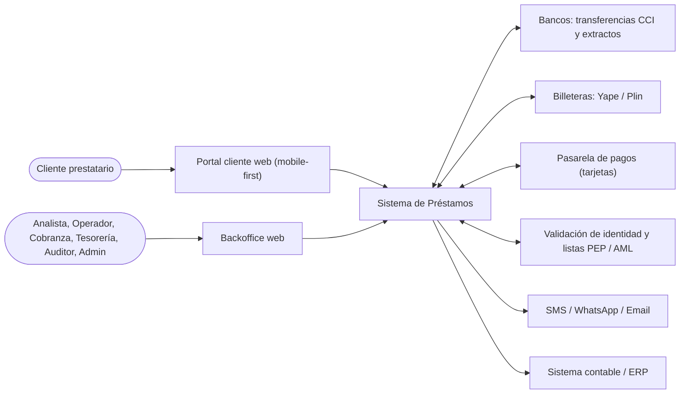
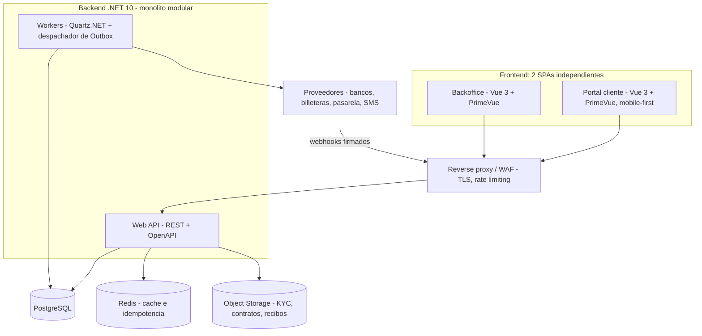
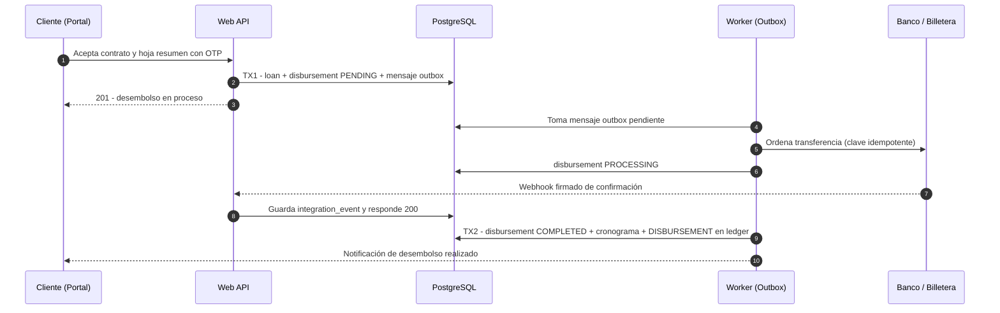
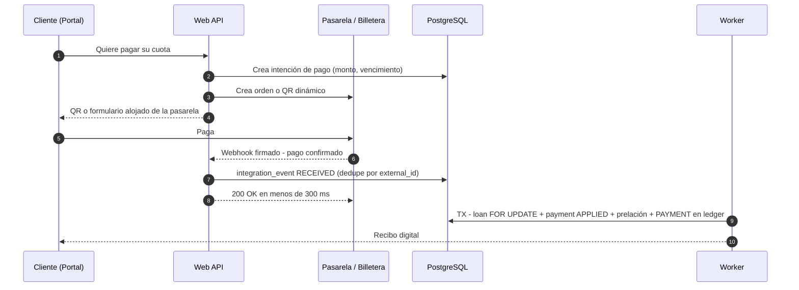

# Arquitectura General — Sistema de Préstamos (Fintech 100% Digital)

Documento único de referencia de la arquitectura. Consolida lo definido en [`README.md`](README.md), [`LINEA_DE_CRECIMIENTO_DEL_PROYECTO.md`](LINEA_DE_CRECIMIENTO_DEL_PROYECTO.md), los dominios de [`docs/`](docs/00-indice-general.md), el esquema de [`database/`](database/docs/README.md) y los tres documentos de [`architecture/`](architecture/).

> **Regla de precedencia:** si algo de `architecture/*.md` contradice este documento, **prevalece este documento**. La sección 13 lista las contradicciones encontradas y cómo se resolvieron.

---

## 1. Contexto y principios

**Modelo operativo:** fintech 100% digital, sin sucursales, cajas, ventanillas ni efectivo.

- **Desembolsos:** solo por transferencia (CCI) o billetera digital, y siempre a una cuenta verificada a nombre del cliente.
- **Pagos:** solo por canales digitales: transferencia bancaria, Yape/Plin, tarjeta de débito y pasarela de pago. La tarjeta de crédito queda sujeta a decisión de negocio.
- **Control del dinero:** el dinero vive en las cuentas bancarias de la empresa. Se controla con un libro mayor inmutable y con conciliación diaria contra el extracto bancario.

**Principios no negociables:**

| # | Principio | Consecuencia técnica |
|---|---|---|
| P1 | El dinero se calcula una vez y se congela | El cronograma es un *snapshot* inmutable; los pagos solo lo consumen |
| P2 | Nada se borra ni se edita en finanzas | Contra-asientos (`REVERSAL`) y `audit_logs` de solo inserción |
| P3 | Precisión exacta | `decimal` en C#, `NUMERIC(18,4)` en BD y redondeo **Half-Up** (`MidpointRounding.AwayFromZero`) a 2 decimales |
| P4 | Prelación estricta | Mora → interés → comisiones → capital |
| P5 | Ningún dinero se da por movido sin confirmación del banco | Desembolsos y pagos nacen pendientes; un voucher del cliente nunca basta |
| P6 | Toda operación que mueve dinero es idempotente | `Idempotency-Key`, `UNIQUE(provider, external_id)` y jobs idempotentes |
| P7 | Separación por dominio desde el día 1 | Monolito modular con fronteras estrictas entre módulos |

---

## 2. Vista de contexto



---

## 3. Vista de contenedores



| Contenedor | Responsabilidad | Escala |
|---|---|---|
| **Backoffice** | Operación interna: originación, tesorería, cobranza, reportes, administración | CDN estático |
| **Portal cliente** | Onboarding, KYC, solicitud, firma, cronograma, pagos, constancias | CDN estático |
| **Web API** | Casos de uso síncronos, recepción de webhooks (solo valida y encola) | Horizontal (sin estado) |
| **Workers** | Outbox, webhooks, mora diaria, conciliación, notificaciones | Horizontal con bloqueo por job |
| **PostgreSQL** | Fuente de verdad transaccional y libro mayor | Vertical + réplica de lectura para reportes |
| **Redis** | Respuestas idempotentes (24 h), cache de catálogos, rate limiting | — |
| **Object Storage** | Archivos KYC, PDFs de contratos y recibos (solo URI + hash en BD) | — |

---

## 4. Módulos del backend

Cada módulo es un **hexágono propio** con `Domain`, `Application` e `Infrastructure`. Los módulos se identifican por nombre, no por número, para evitar las numeraciones cruzadas de los documentos anteriores.

| Módulo | Documento de dominio | Tablas que le pertenecen | Responsabilidad |
|---|---|---|---|
| **Security** | [01](docs/01-seguridad-y-accesos.md) | `users`, `refresh_tokens`, `audit_logs` | Autenticación, RBAC, bitácora |
| **Customers** | [02](docs/02-gestion-de-clientes-y-kyc.md) | `customers`, `customer_bank_accounts`, `customer_documents`, `otp_verifications` | Clientes, KYC, cuentas del cliente, OTP |
| **Products** | [03](docs/03-productos-de-credito.md) | `loan_products` | Productos y motor de amortización |
| **Origination** | [04](docs/04-originacion-y-evaluacion.md) | `loan_applications` | Solicitud, simulación, evaluación, dictamen |
| **Loans** | [05](docs/05-desembolso-y-cronogramas.md), [10](docs/10-refinanciamiento-y-reestructuracion.md) | `loans`, `schedules`, `installments`, `prepayment_quotes` | Préstamo, cronograma, prepago, reestructuración |
| **Payments** | [06](docs/06-pagos-y-cobros.md) | `payments`, `payment_allocations`, `transactions` | Confirmación de pagos, prelación, reversos, libro mayor |
| **Treasury** | [08](docs/08-tesoreria-digital.md) | `company_bank_accounts`, `disbursements`, `bank_statements` | Cuentas propias, envío y seguimiento de desembolsos, conciliación, cuadre diario |
| **Collections** | [07](docs/07-mora-y-cobranzas.md) | `collection_actions` | Mora diaria, aging, gestiones, promesas, castigo |
| **Integrations** | [12](docs/12-integraciones-y-conciliacion.md) | `integration_events` | Webhooks, adaptadores de proveedores, reintentos, DLQ |
| **Notifications** | transversal | `notifications` | SMS, WhatsApp, email y push desacoplados |
| **Administration** | [13](docs/13-administracion-y-configuracion.md) | `company`, `currencies`, `holidays`, `document_types`, `payment_methods`, `legal_templates` | Empresa, canales digitales, feriados, catálogos, plantillas |
| **Reports** | [11](docs/11-reportes-y-estados-de-cuenta.md) | ninguna (solo lectura) | Dashboard, cartera, aging, flujo de caja, estado de cuenta |

El **portal del cliente** ([09](docs/09-portal-del-cliente.md)) no es un módulo de backend: es una SPA que consume endpoints `/api/client/*` de los módulos anteriores, con aislamiento por `customer_id`.

### 4.1 Reglas entre módulos

1. **Un dueño por tabla.** Solo el módulo dueño escribe en sus tablas. Los demás módulos usan su API pública (interfaces en `Application`) o un modelo de lectura.
2. **Llamadas síncronas en proceso** para consultas y validaciones: por ejemplo, Loans consulta a Customers si el KYC está verificado.
3. **Eventos de dominio por Outbox** para efectos entre módulos que deben ocurrir sí o sí:

| Evento | Publica | Reacciona |
|---|---|---|
| `DisbursementCompleted` | Treasury | Loans activa el préstamo y genera el cronograma; Payments asienta el `DISBURSEMENT`; Notifications avisa |
| `DisbursementFailed` | Treasury | Loans deja el préstamo sin vigencia; Notifications pide corregir la cuenta |
| `PaymentConfirmed` | Integrations / Treasury | Payments aplica la prelación y asienta el `PAYMENT`; Notifications envía el recibo |
| `InstallmentOverdue` | Collections | Notifications envía recordatorios; Collections lo agrega a la bandeja |
| `LoanPaidOff` | Payments | Loans cierra el préstamo; Notifications envía la constancia de no adeudo |

---

## 5. Estructura del código

**Decisión:** un monolito modular donde cada módulo es un hexágono (*Ports & Adapters*). Esta estructura reemplaza los tres árboles distintos de `architecture/`.

```text
backend/
├── LoanSystem.sln
├── src/
│   ├── Common/
│   │   ├── LoanSystem.Common.Domain/          # Entity, ValueObject, AggregateRoot, IDomainEvent, Money
│   │   ├── LoanSystem.Common.Application/     # Result<T>, ICommand/IQuery, IUnitOfWork, IClock
│   │   └── LoanSystem.Common.Infrastructure/  # Outbox, idempotencia, interceptor de auditoría, Redis
│   ├── Modules/
│   │   └── <Módulo>/                          # Security, Customers, Products, Origination, Loans,
│   │       │                                  # Payments, Treasury, Collections, Integrations,
│   │       │                                  # Notifications, Administration, Reports
│   │       ├── Domain/                        # Entidades, Value Objects, servicios de dominio,
│   │       │   └── Ports/Outbound/            # interfaces de repositorios y servicios externos
│   │       ├── Application/                   # Casos de uso (commands/queries)
│   │       │   ├── Ports/Inbound/             # interfaces de casos de uso
│   │       │   └── Contracts/                 # API pública del módulo y eventos que publica
│   │       └── Infrastructure/                # EF Core, Dapper, adaptadores de proveedores
│   ├── WebApi/                                # Host HTTP: endpoints, middlewares, DI
│   └── Workers/                               # Host de jobs: Quartz.NET, Outbox, webhooks
└── tests/
    ├── Domain.UnitTests/                      # Amortización, redondeo, prelación (contra Excel patrón)
    ├── Application.UnitTests/                 # Casos de uso con dobles de prueba
    ├── Architecture.Tests/                    # Verifica que ningún módulo dependa del interior de otro
    └── IntegrationTests/                      # PostgreSQL y Redis reales con Testcontainers

frontend/                                      # Vue 3 + PrimeVue (detalle en ARQUITECTURA_FRONTEND.md)
├── apps/
│   ├── backoffice/src/features/               # auth, audit, customers, products, origination, loans,
│   │                                          # payments, treasury, integrations, collections, reports, admin
│   └── portal/src/features/                   # auth, onboarding, applications, contract, loans,
│                                              # payments, profile, notifications, complaints
└── packages/
    ├── api-client/                            # Axios + tipos generados desde OpenAPI (fuente única)
    ├── ui/                                    # Preset de PrimeVue, Tailwind y componentes compartidos
    ├── utils/                                 # Formatos es-PE, fechas de negocio, esquemas Zod comunes
    └── config/                                # tsconfig, ESLint, Prettier
```

---

## 6. Flujos críticos

### 6.1 Onboarding y KYC
1. El cliente se registra en el portal y valida su teléfono o correo con OTP.
2. Sube su DNI (anverso y reverso) y una selfie. Los archivos van a Object Storage y en la BD solo se guardan la URI y el SHA-256.
3. Se valida contra el proveedor de identidad y las listas PEP/AML. Un analista revisa los casos dudosos.
4. Registra su cuenta de desembolso. Queda `PENDING_VERIFICATION` hasta confirmar que está a nombre del cliente.
5. Sin `kyc_status = VERIFIED` y sin cuenta verificada **no hay desembolso**.

### 6.2 Originación, contrato y desembolso (asíncrono)



- La fecha de inicio de intereses es la **fecha de confirmación bancaria**.
- Un `FAILED` no genera cronograma ni asiento; pasa a la bandeja de tesorería ([US-25](docs/08-tesoreria-digital.md)).
- La transferencia nunca se envía dentro de la transacción de BD: el Outbox garantiza que se envíe **una sola vez** y solo si TX1 se confirmó.

### 6.3 Pago digital



- **Sin webhook** (transferencia por CCI con voucher): el pago queda `PENDING_CONFIRMATION` y solo se aplica cuando aparece en el extracto conciliado.
- La mora se calcula con la **fecha efectiva de la operación** (`paid_at`), no con la hora en que llegó la confirmación.

### 6.4 Conciliación y cuadre diario
1. Los extractos entran a `bank_statements` por archivo, API del banco o webhook. Hay `UNIQUE (cuenta, operation_number)`.
2. **Match automático:** `external_reference` + monto + fecha, y luego documento del cliente en la glosa + monto.
3. Lo que no cuadra va a la bandeja manual ([US-37](docs/12-integraciones-y-conciliacion.md)).
4. **Cuadre diario por cuenta** ([US-24](docs/08-tesoreria-digital.md)): libro mayor contra extracto, con resultado `CUADRADO` o `DESCUADRADO`.

---

## 7. Datos y consistencia

| Tema | Decisión |
|---|---|
| **Base de datos** | Una sola instancia PostgreSQL; cada tabla tiene un módulo dueño (sección 4) |
| **Migraciones** | *SQL-first*: los archivos de `database/migrations` son la fuente de verdad, ejecutados por un runner versionado (DbUp o Flyway). EF Core **no** genera migraciones, para no tener dos fuentes |
| **Dinero** | `decimal` + `NUMERIC(18,4)`; cuotas redondeadas a 2 decimales con `MidpointRounding.AwayFromZero`. Ojo: `Math.Round` usa `ToEven` por defecto, así que **siempre** se indica el modo |
| **Libro mayor** | `transactions` es de solo inserción; el sentido lo da `direction`; correcciones solo por contra-asiento |
| **Concurrencia** | Cada caso de uso que mueve dinero corre dentro de **una transacción explícita** con `SELECT ... FOR UPDATE` sobre el préstamo. Si usa saldo a favor, también bloquea al cliente. Sin transacción, el bloqueo no dura |
| **Idempotencia** | 1) HTTP: `Idempotency-Key` → respuesta en Redis por 24 h + `UNIQUE` en BD como garantía final. 2) Webhooks: `UNIQUE(provider, external_id)`. 3) Jobs: marcas como `last_mora_calc_date` |
| **Outbox** | Los efectos externos (transferencias, notificaciones) y los eventos entre módulos se escriben en la misma transacción del cambio y los despacha un worker. Para el MVP no hace falta un broker |
| **Tiempo** | `TIMESTAMPTZ` en UTC; las fechas de negocio y los jobs usan `America/Lima`; feriados desde `holidays` |
| **Reportes** | Se leen desde una réplica o vistas materializadas, nunca desde el primario en horas pico |

---

## 8. Integraciones externas

**Webhooks entrantes** ([US-36](docs/12-integraciones-y-conciliacion.md)):
1. Leer el **cuerpo crudo** de la petición. El HMAC-SHA256 se calcula sobre esos bytes, no sobre el objeto deserializado.
2. Validar la firma y el *timestamp*, con una ventana de ±5 minutos contra *replays*.
3. Guardar en `integration_events`. Si el `external_id` ya existe, responder `200` sin hacer nada más.
4. Responder `200` en menos de 300 ms y procesar en el worker. Reintentos: 30 s, 2 min, 10 min y 30 min; después pasa a DLQ.

**Llamadas salientes** (transferencias, órdenes de cobro, consulta de estado):
- Siempre con clave idempotente propia, *timeout* y reintento con *backoff*.
- Un adaptador por proveedor detrás de un puerto común: `IBankTransferGateway`, `IPaymentGateway`, `IIdentityVerifier`, `IMessageSender`.
- Ambiente `staging` conectado a los *sandbox* de cada proveedor.

**Liquidaciones de pasarela:** las pasarelas depositan en lote, descontando su comisión y días después. La conciliación debe soportar **1 depósito ↔ N pagos** y registrar la comisión (pendiente P11).

---

## 9. Seguridad

| Área | Medida |
|---|---|
| **Backoffice** | Correo + contraseña (Argon2id) + **MFA obligatorio** (TOTP) para los roles que mueven dinero; bloqueo tras 5 intentos; JWT corto + *refresh token* rotativo |
| **Portal cliente** | OTP por SMS o WhatsApp; **verificación adicional** para firmar el contrato, cambiar la cuenta bancaria o ver datos sensibles; espera de 24–48 h antes de desembolsar a una cuenta recién cambiada (mitiga *SIM swap* y robo de cuenta) |
| **Autorización** | RBAC por política en cada endpoint (`ROLE_ADMIN`, `ROLE_ANALYST`, `ROLE_OPERATOR`, `ROLE_COLLECTOR`, `ROLE_AUDITOR`, `ROLE_CLIENT`); el cliente solo ve registros con su `customer_id` |
| **Cuatro ojos** | Reversos, castigos, ajustes manuales y cambios de tasa requieren aprobación de un segundo usuario |
| **Tarjetas** | Solo *checkout* o campos alojados de la pasarela; **nunca** pasa un número de tarjeta por nuestros servidores (alcance PCI DSS mínimo); se guarda solo el token |
| **Datos personales** | Cifrado en tránsito (TLS 1.2+) y en reposo; enmascarado de cuentas; consentimientos por finalidad y versionados (Ley 29733); URLs firmadas y temporales para archivos |
| **Secretos** | Gestor de secretos (credenciales bancarias, HMAC, JWT); nada en BD ni en el repositorio |
| **Auditoría** | `audit_logs` de solo inserción alimentado por interceptor de EF Core; registro de accesos a datos sensibles |

---

## 10. Procesos en segundo plano

| Job | Frecuencia (hora Lima) | Qué hace | Cómo evita duplicados |
|---|---|---|---|
| Despachador de Outbox | Continuo | Envía transferencias, notificaciones y eventos entre módulos | Id del mensaje + estado |
| Procesador de webhooks | Continuo | `integration_events` de `RECEIVED` a `PROCESSED`, con reintentos y DLQ | `UNIQUE(provider, external_id)` |
| Mora diaria | 00:05 | `late_fee`, `days_late` y estados `OVERDUE` / `EN_MORA` | `last_mora_calc_date` |
| Desembolsos en tránsito | Cada 15 min | Consulta el estado al banco y alerta si sigue `PROCESSING` más de N horas | Estado del desembolso |
| Importación de extractos | Diario o por API | Carga `bank_statements` y ejecuta el match automático | `UNIQUE(cuenta, operation_number)` |
| Cuadre diario | 06:00 | Cuadre por cuenta bancaria ([US-24](docs/08-tesoreria-digital.md)) | Cuenta + fecha |
| Promesas incumplidas | Diario | Marca `PROMESA_INCUMPLIDA` ([RF-21.3](docs/07-mora-y-cobranzas.md)) | Estado de la acción |
| Recordatorios | Diario 09:00 | Avisos preventivos y de mora, respetando horarios permitidos | Plantilla + cuota + fecha |

Cada job corre con un **bloqueo distribuido** (por ejemplo, el *clustering* de Quartz.NET sobre PostgreSQL) para que dos instancias no lo ejecuten a la vez.

---

## 11. Stack tecnológico

| Capa | Elección | Nota |
|---|---|---|
| Runtime backend | **.NET 10 LTS / C# 14** | Soporte hasta noviembre de 2028. **.NET 8 deja de tener soporte el 10 de noviembre de 2026**: no iniciar el proyecto sobre él |
| API | ASP.NET Core (Minimal APIs) + OpenAPI integrado + Scalar | Contrato OpenAPI como fuente para el frontend y los proveedores |
| Escrituras | EF Core 10 + Npgsql | Sin migraciones de EF (ver sección 7) |
| Lecturas | Dapper | Reportes, aging, dashboard |
| Base de datos | PostgreSQL 17 o 18 | PostgreSQL 18 trae `uuidv7()` nativo (claves ordenadas en el tiempo, opcional) |
| Cache | Redis | Idempotencia, catálogos, rate limiting |
| Jobs | Quartz.NET | Licencia Apache 2.0; zona horaria `America/Lima` explícita |
| Mensajería | Outbox en PostgreSQL | RabbitMQ solo cuando el volumen lo exija |
| Despacho de casos de uso | Despachador propio sencillo | MediatR v13+ tiene licencia comercial: si se usa, presupuestarla |
| PDF | QuestPDF | Licencia Community gratuita solo bajo USD 1M de ingresos anuales; validar |
| Pruebas | xUnit + Testcontainers + Shouldly o AwesomeAssertions | FluentAssertions v8+ tiene licencia comercial |
| Observabilidad | OpenTelemetry (trazas, métricas, logs) + Serilog | Id de correlación de extremo a extremo, incluido `external_reference` |
| Frontend | Vue 3 + TypeScript + Vite, PrimeVue, Tailwind CSS, Vue Router, Pinia, Axios, VueUse, Chart.js, VeeValidate + Zod | Detalle en [`ARQUITECTURA_FRONTEND.md`](ARQUITECTURA_FRONTEND.md); tipos generados desde OpenAPI en `packages/api-client` |
| Archivos | Object Storage compatible con S3 o Azure Blob | Cifrado en reposo; URLs firmadas |
| Infraestructura | Docker + CI/CD; ambientes `dev`, `qa`, `staging`, `prod` | Backups con recuperación a un punto en el tiempo (PITR) y restauración probada |

---

## 12. Decisiones de arquitectura (ADR)

| ADR | Decisión | Alternativa descartada |
|---|---|---|
| 01 | Monolito modular con hexágono por módulo | Microservicios desde el inicio |
| 02 | .NET 10 LTS + PostgreSQL | .NET 8 (sin soporte desde nov-2026); Java/Spring (el equipo y los documentos ya apuntan a .NET) |
| 03 | Esquema *SQL-first* con runner de migraciones | Migraciones generadas por EF Core |
| 04 | Desembolsos y pagos asíncronos, confirmados por el banco | Marcar como pagado o desembolsado al registrar |
| 05 | Outbox transaccional para efectos externos y eventos | Llamar al banco dentro de la transacción de BD |
| 06 | Webhooks validados sobre el cuerpo crudo y procesados en segundo plano | Procesar el pago dentro de la petición del webhook |
| 07 | Tarjetas solo tokenizadas por la pasarela | Guardar datos de tarjeta |
| 08 | Dos SPAs separadas (backoffice y portal) | Una sola aplicación con roles |
| 09 | Conciliación y cuentas bancarias en **Treasury**; transporte de proveedores en **Integrations** | Mezclar conciliación con webhooks |
| 10 | Frontend en **Vue 3 + PrimeVue + Tailwind**, monorepo pnpm con dos apps | React 18/19 de los documentos anteriores |

---

## 13. Revisión de `architecture/`: contradicciones y resolución

| # | Tema | Dónde | Problema | Resolución |
|---|---|---|---|---|
| 1 | Versión de .NET | Los 3 documentos | Usan .NET 8 / C# 12 / EF Core 8, cuyo soporte termina el 10-nov-2026 | .NET 10 LTS / C# 14 / EF Core 10 (secciones 11 y 12) |
| 2 | Estructura del código | Los 3 documentos | Tres árboles distintos: `Core/Adapters` (hexagonal), `Modules/<M>/Domain…` (backend-net) y módulos con puertos (recomendada) | Monolito modular con hexágono por módulo (sección 5) |
| 3 | Numeración de módulos | backend-net vs. recomendada vs. `docs/` | Payments es 06 o 07, Collections 07 o 09, Loans "05 y 06" | Módulos por nombre, con tabla de mapeo (sección 4) |
| 4 | Módulos faltantes | backend-net y recomendada | No existen Administration ni Notifications; backend-net no tiene Reports | Agregados (sección 4) |
| 5 | Conciliación | backend-net (Integrations) | Integrations incluye `Reconciliation` y `BankAccount`; la tabla `reconciliations` ya no existe | Treasury es dueño de `company_bank_accounts`, `disbursements` y `bank_statements` (ADR 09) |
| 6 | Redondeo | backend-net §1.2 | "Redondeo bancario o `AwayFromZero` (Half-Up)": el redondeo bancario es `ToEven`, que es distinto | Siempre `MidpointRounding.AwayFromZero` explícito (sección 7) |
| 7 | Webhook | hexagonal §3.1 | Aplica el pago dentro de la petición y valida la firma sobre el objeto deserializado; no deduplica por `external_id` | Cuerpo crudo + HMAC + timestamp, `integration_events` y procesamiento en worker (sección 8) |
| 8 | Bloqueo pesimista | hexagonal §3.2 | `FOR UPDATE` sin transacción explícita: el bloqueo se libera al terminar la consulta | Caso de uso dentro de una transacción (sección 7) |
| 9 | Desembolso | hexagonal, backend-net | Se trata como operación síncrona; no hay Outbox | Flujo asíncrono con Outbox (sección 6.2, ADR 04 y 05) |
| 10 | Jobs | backend-net | "Quartz / Hangfire" sin decidir | Quartz.NET con *clustering* (sección 10) |
| 11 | Mensajería | recomendada, `docs/12` RNF-24 | Redis Pub/Sub, RabbitMQ y "colas" sin una decisión | Outbox en PostgreSQL para el MVP; broker solo si hace falta |
| 12 | Licencias | backend-net §6 | MediatR y FluentAssertions ahora tienen licencia comercial; QuestPDF tiene un límite de ingresos | Alternativas indicadas en la sección 11 |
| 13 | Stack en README | `README.md` §9 | "Java + Spring Boot o .NET" sin decidir | .NET (ADR 02) |
| 14 | Nombres de puertos | hexagonal | `ILoanDisbursementUseCase` e `IDisburseLoanUseCase` para lo mismo | Convención `I<Verbo><Objeto>UseCase`: `IDisburseLoanUseCase` |

---

## 14. Pendientes de modelado (backlog técnico)

Estos puntos están identificados en los dominios, pero aún **no están en el esquema SQL**:

| # | Pendiente | Afecta a |
|---|---|---|
| P1 | Estado previo a la confirmación del desembolso: `loans.status` hoy nace en `VIGENTE` | `loan_status`, Loans |
| P2 | `payments.status` debe nacer en `PENDING_CONFIRMATION` (hoy `DEFAULT 'APPLIED'`) | Payments |
| P3 | `disbursements.loan_id UNIQUE` impide reintentar tras un `FAILED`: cambiarlo por un índice único parcial sobre los estados activos | Treasury |
| P4 | Tipos de transacción `REFUND`, `CHARGEBACK` y `GATEWAY_FEE` | `transaction_type` |
| P5 | Tabla de **intención de pago** (orden o QR con monto, vencimiento e id de pasarela) | Payments |
| P6 | `UNIQUE (payment_method_id, gateway_reference)` en `payments` | Payments |
| P7 | **Evidencia de firma electrónica**: versión de plantilla, hash del PDF, OTP, IP, user-agent y fecha | Loans |
| P8 | **Verificaciones KYC** automáticas (identidad, biometría, listas) con proveedor, score y respuesta | Customers |
| P9 | `otp_verifications`: propósito (login, contrato, cambio de cuenta) y contador de intentos | Customers |
| P10 | Tabla `outbox_messages` | Common |
| P11 | Liquidaciones de pasarela en lote (1 depósito ↔ N pagos) | Treasury |
| P12 | Garantizar por FK compuesta que la cuenta destino del desembolso pertenece al cliente del préstamo | Treasury, Customers |
| P13 | Token de la pasarela en `customer_bank_accounts` para tarjetas | Customers |
| P14 | Consentimientos versionados por finalidad (hoy solo `consent_given_at`) | Customers |
| P15 | `fn_update_disbursement_on_confirmation`: documentada, sin implementar (o resolverla en el worker) | Treasury |

**Por validar con asesoría legal y contable (Perú):** derecho de prepago sin penalidad (Ley 29571, art. 85), tasas máximas del BCRP, IGV y comprobantes electrónicos SUNAT si la empresa no está supervisada por la SBS, registro ante la SBS/UIF (PLAFT) y límites de horario y frecuencia en la cobranza digital.

---

## 15. Documentos relacionados

| Tema | Documento |
|---|---|
| Visión y reglas de negocio | [`README.md`](README.md) |
| Etapas de crecimiento | [`LINEA_DE_CRECIMIENTO_DEL_PROYECTO.md`](LINEA_DE_CRECIMIENTO_DEL_PROYECTO.md) |
| Historias de usuario por dominio | [`docs/00-indice-general.md`](docs/00-indice-general.md) |
| Esquema de base de datos | [`database/docs/README.md`](database/docs/README.md) y [`database/run_all.sql`](database/run_all.sql) |
| Detalle del hexágono en .NET | [`architecture/arquitectura-hexagonal.md`](architecture/arquitectura-hexagonal.md) |
| Detalle del backend .NET | [`architecture/backend-net-architecture.md`](architecture/backend-net-architecture.md) |
| Arquitectura del frontend (Vue) | [`ARQUITECTURA_FRONTEND.md`](ARQUITECTURA_FRONTEND.md) |
| Requerimientos por capa | [`docs/REQUERIMIENTOS_FRONTEND.md`](docs/REQUERIMIENTOS_FRONTEND.md), [`docs/REQUERIMIENTOS_BACKEND.md`](docs/REQUERIMIENTOS_BACKEND.md), [`docs/REQUERIMIENTOS_BDD.md`](docs/REQUERIMIENTOS_BDD.md) |
| Contratos y errores (detalle previo) | [`architecture/arquitectura-recomendada.md`](architecture/arquitectura-recomendada.md) |
