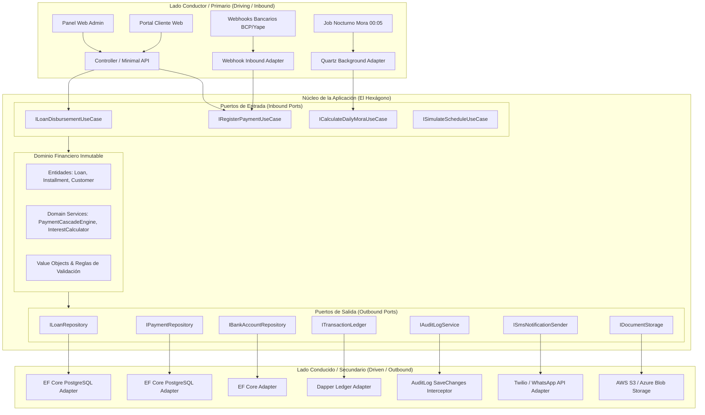

# Arquitectura Hexagonal (Ports & Adapters) en .NET 8 — Sistema de Préstamos

> **Documento de detalle.** La referencia vigente es [`ARQUITECTURA_GENERAL.md`](../ARQUITECTURA_GENERAL.md). Si algo aquí la contradice (versión .NET 8, estructura de carpetas, webhook síncrono, bloqueo sin transacción), prevalece ese documento; ver su sección 13.

Este documento detalla la implementación formal del patrón de **Arquitectura Hexagonal (Ports and Adapters)** propuesta por Alistair Cockburn, adaptada al ecosistema **.NET 8 / C# 12** dentro del contexto del Sistema Financiero y de Préstamos.

---

## 1. Fundamentos de la Arquitectura Hexagonal

El principio rector es **desacoplar el núcleo de negocio de cualquier detalle tecnológico o de infraestructura**:
- El **Núcleo de Dominio (Domain Core)** no conoce bases de datos, pasarelas de pago, protocolos HTTP, ni bibliotecas externas.
- La comunicación hacia adentro y hacia afuera ocurre exclusivamente a través de **Puertos (Ports)**.
- Los **Adaptadores (Adapters)** traducen la interacción del mundo exterior hacia los puertos del sistema o viceversa.



---

## 2. Los Componentes del Hexágono

### 2.1 El Núcleo de Dominio (Domain Core)
Contiene las entidades y la lógica matemática financiera pura. No tiene referencias a ningún paquete NuGet de terceros ni a Entity Framework.

- **Entidades de Dominio:** `Loan`, `Schedule`, `Installment`, `Payment`, `Customer`, `Disbursement`, `CompanyBankAccount`.
- **Servicios de Dominio:**
  - `PaymentCascadeEngine`: Aplica la prelación obligatoria (**Mora $\to$ Interés $\to$ Comisiones $\to$ Capital**).
  - `AmortizationScheduleGenerator`: Implementa fórmulas (Francés, Flat, Alemán, Americano) con ajuste obligatorio de centavos en cuota final.
- **Value Objects:** `Money`, `InterestRate`, `DniNumber`, `DocumentReference`.

### 2.2 Puertos (Ports)

Los puertos son **interfaces C# puras** que definen qué necesita el sistema, sin importar cómo se implemente:

#### A. Puertos de Entrada (Driving / Inbound Ports)
Representan los casos de uso que el mundo exterior puede invocar:

```csharp
namespace LoanSystem.Hexagon.Domain.Ports.Inbound;

public interface IRegisterPaymentUseCase
{
    Task<PaymentResult> ExecuteAsync(RegisterPaymentCommand command, CancellationToken ct = default);
}

public interface IDisburseLoanUseCase
{
    Task<DisbursementResult> ExecuteAsync(DisburseLoanCommand command, CancellationToken ct = default);
}

public interface ICalculateDailyMoraUseCase
{
    Task<MoraJobSummary> ExecuteDailyBatchAsync(DateTime evaluationDate, CancellationToken ct = default);
}
```

#### B. Puertos de Salida (Driven / Outbound Ports)
Representan las dependencias que el dominio requiere de la infraestructura (persistencia, notificaciones, almacenamiento):

```csharp
namespace LoanSystem.Hexagon.Domain.Ports.Outbound;

public interface ILoanRepository
{
    Task<Loan?> GetByIdWithInstallmentsForUpdateAsync(Guid loanId, CancellationToken ct = default);
    Task AddAsync(Loan loan, CancellationToken ct = default);
    Task UpdateAsync(Loan loan, CancellationToken ct = default);
}

public interface IPaymentRepository
{
    Task AddAsync(Payment payment, CancellationToken ct = default);
    Task<bool> ExistsWithIdempotencyKeyAsync(string idempotencyKey, CancellationToken ct = default);
}

public interface ITransactionLedger
{
    Task AppendEntryAsync(LedgerTransaction transaction, CancellationToken ct = default);
}

public interface IDocumentStorage
{
    Task<string> UploadFileAsync(Stream fileStream, string fileName, string contentType, CancellationToken ct = default);
}
```

---

## 3. Adaptadores (Adapters)

### 3.1 Adaptadores Primarios / Conductores (Driving Adapters)
Traducen las peticiones externas al formato que entienden los puertos de entrada:

#### Adaptador HTTP / ASP.NET Core Controller:
```csharp
[ApiController]
[Route("api/loans")]
public class LoansController : ControllerBase
{
    private readonly IRegisterPaymentUseCase _registerPaymentUseCase;

    public LoansController(IRegisterPaymentUseCase registerPaymentUseCase)
    {
        _registerPaymentUseCase = registerPaymentUseCase;
    }

    [HttpPost("{id:guid}/payments")]
    [Authorize(Roles = "ROLE_OPERATOR,ROLE_ADMIN")]
    public async Task<IActionResult> Pay(
        [FromRoute] Guid id,
        [FromBody] RegisterPaymentRequest request,
        [FromHeader(Name = "Idempotency-Key")] string idempotencyKey)
    {
        var command = new RegisterPaymentCommand(id, request.Amount, request.PaymentMethod, request.Reference, idempotencyKey);
        var result = await _registerPaymentUseCase.ExecuteAsync(command);

        return Ok(result);
    }
}
```

#### Adaptador Webhook Bancario (BCP / Yape):
```csharp
[ApiController]
[Route("api/integrations/webhooks")]
public class BankWebhooksController : ControllerBase
{
    private readonly IRegisterPaymentUseCase _registerPaymentUseCase;
    private readonly IWebhookSignatureValidator _signatureValidator;

    public BankWebhooksController(
        IRegisterPaymentUseCase registerPaymentUseCase,
        IWebhookSignatureValidator signatureValidator)
    {
        _registerPaymentUseCase = registerPaymentUseCase;
        _signatureValidator = signatureValidator;
    }

    [HttpPost("{provider}")]
    public async Task<IActionResult> ReceiveWebhook(
        [FromRoute] string provider,
        [FromBody] BankWebhookPayload rawPayload,
        [FromHeader(Name = "X-Signature")] string signature)
    {
        // 1. Validar firma criptográfica HMAC-SHA256
        if (!_signatureValidator.IsValid(provider, rawPayload, signature))
            return Unauthorized(new { message = "Firma inválida" });

        // 2. Mapear a comando de entrada y ejecutar el puerto
        var command = rawPayload.ToPaymentCommand();
        await _registerPaymentUseCase.ExecuteAsync(command);

        return Ok(new { status = "ACK" });
    }
}
```

### 3.2 Adaptadores Secundarios / Conducidos (Driven Adapters)
Implementan los puertos de salida comunicándose con tecnologías concretas:

#### Adaptador EF Core PostgreSQL con Bloqueo Pesimista:
```csharp
public class EfLoanRepository : ILoanRepository
{
    private readonly LoanDbContext _context;

    public EfLoanRepository(LoanDbContext context) => _context = context;

    public async Task<Loan?> GetByIdWithInstallmentsForUpdateAsync(Guid loanId, CancellationToken ct = default)
    {
        // Aplica SELECT ... FOR UPDATE a nivel de PostgreSQL para evitar carreras concurrentes
        return await _context.Loans
            .FromSqlInterpolated($"SELECT * FROM loans WHERE id = {loanId} FOR UPDATE")
            .Include(l => l.Installments)
            .FirstOrDefaultAsync(ct);
    }

    public async Task UpdateAsync(Loan loan, CancellationToken ct = default)
    {
        _context.Loans.Update(loan);
        await _context.SaveChangesAsync(ct);
    }
}
```

---

## 4. Estructura de Proyectos en Solución Hexagonal (.NET 8)

```text
src/
├── Core/
│   ├── LoanSystem.Domain/                     # CENTRO DEL HEXÁGONO (Sin dependencias externas)
│   │   ├── Model/                             # Entidades de negocio, Value Objects, Aggregate Roots
│   │   ├── Services/                          # Lógica financiera pura (Prelación, Fórmulas, Amortización)
│   │   └── Ports/
│   │       ├── Inbound/                       # Interfaces de Casos de Uso (ILoanDisbursementUseCase)
│   │       └── Outbound/                      # Interfaces de Dependencias (ILoanRepository, ITransactionLedger)
│   │
│   └── LoanSystem.Application/                # Casos de uso concretos que implementan los Inbound Ports
│       ├── UseCases/
│       │   ├── DisburseLoan/                  # DisburseLoanUseCase.cs
│       │   ├── RegisterPayment/               # RegisterPaymentUseCase.cs (Casacada de prelación)
│       │   └── CalculateDailyMora/            # CalculateDailyMoraUseCase.cs
│       └── Dtos/                              # Request / Response DTOs
│
└── Adapters/
    ├── Inbound/
    │   ├── LoanSystem.Adapters.WebApi/        # ASP.NET Core Controllers & Minimal APIs
    │   ├── LoanSystem.Adapters.Webhooks/      # Receptores de pasarelas BCP/Yape/Plin
    │   └── LoanSystem.Adapters.Jobs/          # Quartz.NET / Background Workers (Cálculo diario)
    │
    └── Outbound/
        ├── LoanSystem.Adapters.PostgreSql/    # Entity Framework Core 8, DbContext, Mappers, Migrations
        ├── LoanSystem.Adapters.Dapper/        # Consultas de lectura ultra-rápidas para reportes y aging
        ├── LoanSystem.Adapters.S3Storage/     # AWS S3 / Azure Blob para expedientes KYC
        ├── LoanSystem.Adapters.Notifications/ # Twilio SMS / WhatsApp Business Cloud API
        └── LoanSystem.Adapters.QuestPdf/      # Motor tipográfico de contratos PDF y pagarés
```

---

## 5. Matriz de Ventajas de la Arquitectura Hexagonal en este Proyecto

| Beneficio | Impacto en el Sistema de Préstamos |
|---|---|
| **Testabilidad Incomparable** | Las fórmulas de cálculo financiero, amortización y prelación se prueban al 100% en memoria con mocks simples, sin requerir base de datos ni servidor web levantado. |
| **Independencia de la Base de Datos** | Si el día de mañana se cambia PostgreSQL por SQL Server o se introduce MongoDB para auditoría, el dominio y los casos de uso permanecen intactos. |
| **Múltiples Clientes para el Mismo Caso de Uso** | El caso de uso `RegisterPaymentUseCase` es invocado indistintamente por el Operador en el Panel Web (pago identificado en el extracto), por el Webhook del BCP o por un Job de conciliación automática, sin duplicar ni una sola línea de lógica financiera. |
| **Aislamiento contra Caídas Externas** | Si el proveedor de SMS o de almacenamiento de archivos falla, el núcleo financiero puede seguir procesando pagos y desembolsos registrando los reintentos mediante adaptadores de fallback. |
