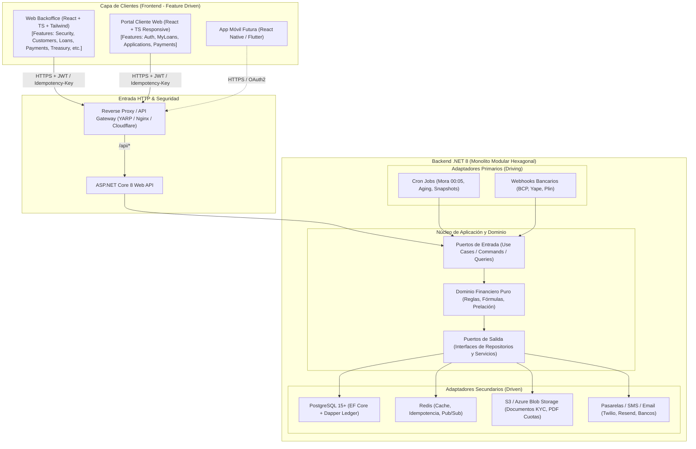

# Arquitectura Global del Sistema — Backend Hexagonal (.NET 8) y Frontend Feature-Driven

> **Documento de detalle.** La referencia vigente es [`ARQUITECTURA_GENERAL.md`](../ARQUITECTURA_GENERAL.md). Si algo aquí la contradice (versión .NET 8, React 18, mensajería), prevalece ese documento; ver su sección 13. **El frontend React descrito aquí fue reemplazado por Vue 3 + shadcn-vue:** ver [`ARQUITECTURA_FRONTEND.md`](../ARQUITECTURA_FRONTEND.md).

Este documento define la **arquitectura integral de referencia** para la plataforma de Préstamos y Créditos. Consolida el diseño técnico requerido tras el análisis completo de los requisitos de negocio (`README.md`, `LINEA_DE_CRECIMIENTO_DEL_PROYECTO.md`, `docs/`, `database/`), alineando:
1. **Backend:** Arquitectura Hexagonal (Ports & Adapters) estructurada bajo un Monolito Modular en **.NET 8 / C# 12**.
2. **Frontend:** Arquitectura Basada en Funcionalidades (**Feature-Driven / Vertical Slice**) en **React 18+ con TypeScript / Vite**, separando la aplicación de Backoffice y el Portal del Cliente.
3. **Contratos e Integración:** Comunicación desacoplada, gestión de estado, idempotencia financiera y pipeline CI/CD independiente.

---

## 1. Visión General del Ecosistema

El sistema desacopla totalmente el ciclo de vida del backend del frontend, permitiendo despliegues independientes, alta observabilidad y escalabilidad modular:



---

## 2. Backend: Arquitectura Hexagonal en .NET 8

### 2.1 Principios del Dominio Financiero
- **Precisión Decimal Obligatoria:** Uso exclusivo de `decimal` (128 bits) para evitar pérdida por coma flotante binaria.
- **Inmutabilidad y Auditoría:** Cronogramas congelados tras el desembolso. Modificaciones realizadas únicamente mediante transacciones compensatorias (contra-asientos) registradas en el Libro Mayor (`transactions`).
- **Prelación Estricta de Cobranza:** Todo abono se distribuye de manera invariable:
  $$\text{Pago} \longrightarrow \text{Mora/Penalidades} \longrightarrow \text{Interés Vencido/Corriente} \longrightarrow \text{Comisiones/Seguros} \longrightarrow \text{Amortización Capital}$$
- **Ajuste de Redondeo:** En la cuota $n$ de cualquier método de amortización (Francés, Flat, Alemán, Americano), el capital pendiente residual se compensa automáticamente para que $\sum \text{Capital} = \text{Monto Desembolsado}$.

### 2.2 Estructura del Código Backend (`/backend`)

```text
backend/
├── LoanSystem.sln
├── src/
│   ├── Common/                                  # Abstracciones globales reutilizables
│   │   ├── LoanSystem.Common.Domain/            # Entity, ValueObject, AggregateRoot, IDomainEvent
│   │   ├── LoanSystem.Common.Application/       # Result<T>, PaginatedList<T>, ICommand, IQuery
│   │   └── LoanSystem.Common.Infrastructure/    # Interceptores EF Core, IdempotencyFilter, RedisLock
│   │
│   ├── Modules/                                 # Módulos Funcionales Aislados
│   │   ├── Security/                            # Módulo 01: Auth, RBAC, Auditoría
│   │   ├── Customers/                           # Módulo 02: Clientes, Expediente KYC, Documentos
│   │   ├── Products/                            # Módulo 03: Motor Financiero (Francés, Flat, Alemán)
│   │   ├── Origination/                         # Módulo 04: Solicitud, Scoring DTI, Aprobación
│   │   ├── Loans/                               # Módulo 05: Desembolso, Cronograma Inmutable, Prepago
│   │   ├── Payments/                            # Módulo 06: Recaudación, Prelación en Cascada, Libro Mayor
│   │   ├── Collections/                         # Módulo 07: Mora Diaria, Aging (1-30, 31-60...), Promesas
│   │   ├── Treasury/                            # Módulo 08: Tesorería digital (cuentas bancarias, desembolsos, cuadre vs. extracto)
│   │   ├── Reports/                             # Módulo 09: Cartera, Flujo de Caja, Estados de Cuenta
│   │   └── Integrations/                        # Módulo 10: Conciliación Bancaria, Webhooks HMAC
│   │
│   │   # ESTRUCTURA INTERNA DE CADA MÓDULO (Ejemplo: Payments):
│   │   # ├── Domain/                            # Núcleo puro: Payment, Allocation, Transaction
│   │   # │   ├── Entities/
│   │   # │   ├── ValueObjects/
│   │   # │   ├── Services/ (PaymentCascadeEngine)
│   │   # │   └── Ports/Outbound/ (IPaymentRepository, ILedgerRepository)
│   │   # ├── Application/                       # Casos de uso
│   │   # │   ├── Ports/Inbound/ (IRegisterPaymentUseCase)
│   │   # │   ├── Commands/ (RegisterPaymentCommand, ReversePaymentCommand)
│   │   # │   └── Queries/ (GetPaymentReceiptQuery)
│   │   # └── Infrastructure/                    # Adaptadores secundarios
│   │       ├── Persistence/ (PaymentDbContext, Repositorios EF Core)
│   │       └── ExternalServices/ (ReceiptPdfQuestPdfAdapter)
│   │
│   ├── WebApi/                                  # Adaptador Primario HTTP (Host ASP.NET Core)
│   │   ├── Controllers/ o Endpoints/            # Minimal APIs agrupadas por versión y rol
│   │   ├── Middlewares/                         # ExceptionHandler, IdempotencyMiddleware, JwtAuth
│   │   ├── Program.cs
│   │   └── appsettings.json
│   │
│   └── BackgroundWorkers/                       # Adaptador Primario Programado
│       └── LoanSystem.Workers/                  # Cron Quartz (Cálculo de mora 00:05, reintentos)
│
└── tests/
    ├── Domain.UnitTests/                        # Pruebas matemáticas de amortización y prelación
    ├── Application.UnitTests/                   # Pruebas de casos de uso con Mocks
    └── IntegrationTests/                        # Pruebas contra PostgreSQL y Redis en Testcontainers
```

---

## 3. Frontend: Arquitectura Basada en Funcionalidades (Feature-Driven)

En lugar de agrupar por tipo técnico de archivo (`/components`, `/hooks`, `/services`), el frontend se organiza **por casos de uso y módulos del negocio**. Si una funcionalidad cambia o se retira, todo su código se encuentra dentro de su propia carpeta.

Se definen dos aplicaciones frontend independientes o un monorepo frontend con dos Single Page Applications (SPA):
1. **`backoffice`**: Panel administrativo para analistas, supervisores, operadores, tesorería y administradores (sin cajas ni ventanillas: operación 100% digital).
2. **`client-portal`**: Portal público optimizado para móviles donde el cliente solicita, consulta su cronograma y abona cuotas.

### 3.1 Estructura del Proyecto Frontend (`/frontend`)

```text
frontend/
├── apps/
│   ├── backoffice/                              # SPA Backoffice (React 18 + Vite + Tailwind + Shadcn/UI)
│   │   ├── index.html
│   │   ├── vite.config.ts
│   │   └── src/
│   │       ├── app/                             # Configuración global, Router y Providers
│   │       │   ├── routes/                      # Definición de rutas protegidas por roles
│   │       │   └── providers/                   # AuthProvider, QueryClientProvider (TanStack Query)
│   │       │
│   │       ├── shared/                          # Recursos compartidos transversales
│   │       │   ├── api/                         # Instancia Axios/Fetch con interceptores de Token y Error
│   │       │   ├── components/                  # UI Atómica: Button, Table, Modal, Badge, DatePicker
│   │       │   ├── hooks/                       # useDebounce, usePagination, useNotification
│   │       │   └── utils/                       # currencyFormatter (PEN/USD), dateFormatter
│   │       │
│   │       └── features/                        # VERTICAL SLICES / DOMINIOS DEL NEGOCIO
│   │           │
│   │           ├── auth/                        # Autenticación, RBAC y sesión
│   │           │   ├── api/ (loginApi.ts)
│   │           │   ├── components/ (LoginForm.tsx, ProtectedRoute.tsx)
│   │           │   ├── hooks/ (useAuth.ts)
│   │           │   └── types/ (auth.types.ts)
│   │           │
│   │           ├── customers/                   # Gestión de Clientes y KYC
│   │           │   ├── api/ (customersApi.ts, kycApi.ts)
│   │           │   ├── components/ (CustomerList.tsx, KycDocumentViewer.tsx, CustomerForm.tsx)
│   │           │   ├── hooks/ (useCustomerDetail.ts)
│   │           │   └── types/ (customer.types.ts)
│   │           │
│   │           ├── origination/                 # Solicitudes y Evaluación DTI
│   │           │   ├── api/ (applicationsApi.ts)
│   │           │   ├── components/ (ApplicationReview.tsx, ScoringSummaryCard.tsx)
│   │           │   └── hooks/ (useOriginationQueue.ts)
│   │           │
│   │           ├── loans/                       # Préstamos, Cronogramas y Simulador
│   │           │   ├── api/ (loansApi.ts, simulatorApi.ts)
│   │           │   ├── components/ (ScheduleTable.tsx, LoanDetailCard.tsx, DisbursementModal.tsx)
│   │           │   ├── hooks/ (useLoanSchedule.ts)
│   │           │   └── types/ (loan.types.ts, schedule.types.ts)
│   │           │
│   │           ├── payments/                    # Pagos digitales: confirmación, prelación y reversos
│   │           │   ├── api/ (paymentsApi.ts)
│   │           │   ├── components/ (PendingPaymentsQueue.tsx, RegisterIdentifiedPaymentModal.tsx, ReceiptPreview.tsx, ReversePaymentDialog.tsx)
│   │           │   └── hooks/ (useProcessPayment.ts)
│   │           │
│   │           ├── treasury/                    # Tesorería digital: cuentas, desembolsos y cuadre diario
│   │           │   ├── api/ (treasuryApi.ts)
│   │           │   ├── components/ (BankAccountsTable.tsx, DisbursementQueue.tsx, DailyBalanceReport.tsx)
│   │           │   └── hooks/ (useBankAccounts.ts, useDisbursementQueue.ts)
│   │           │
│   │           ├── collections/                 # Mora, Aging y Acuerdos de Pago
│   │           │   ├── api/ (collectionsApi.ts)
│   │           │   └── components/ (AgingReportTable.tsx, PromiseActionForm.tsx)
│   │           │
│   │           └── reports/                     # Reportes Financieros y Auditoría
│   │               ├── api/ (reportsApi.ts)
│   │               └── components/ (PortfolioSummaryChart.tsx, AccountStatementView.tsx)
│   │
│   └── client-portal/                           # SPA Portal Cliente (Mobile First / Responsive)
│       └── src/
│           ├── shared/
│           └── features/
│               ├── auth/                        # Login OTP / Clave SMS del cliente
│               ├── loan-application/            # Asistente paso a paso para pedir crédito
│               ├── my-loans/                    # Tarjeta de préstamos activos y cuotas por vencer
│               └── online-payments/             # Pago vía Pasarela (Yape, Plin, Tarjeta)
│
└── package.json                                 # Configuración pnpm / npm workspaces
```

---

## 4. Reglas de Comunicación e Integración Frontend $\longleftrightarrow$ Backend

### 4.1 Contratos de Datos y Tipado
- Los tipos e interfaces de TypeScript en `features/*/types/*.types.ts` son un reflejo exacto de los DTOs de salida y entrada del Backend.
- Se recomienda el uso de herramientas como **OpenAPI Generator** o **NSwag** para generar automáticamente los tipos de TypeScript a partir de `swagger.json`, eliminando desalineaciones entre cliente y servidor.

### 4.2 Idempotencia en Operaciones Financieras Críticas
Toda petición mutable que mueva dinero (`POST /api/loans`, `POST /api/loans/{id}/payments`, `POST /api/payments/{id}/reverse`) envía obligatoriamente una cabecera HTTP generada por el frontend:

```http
POST /api/loans/7c9e6679-7425-40de-944b-e07fc1f90ae7/payments HTTP/1.1
Host: api.prestamos.local
Authorization: Bearer <token>
Idempotency-Key: e8b548b8-6a3f-4e0a-9d0b-68997a44f0b2
Content-Type: application/json

{
  "amount": 250.00,
  "paymentMethodId": "018f...-transferencia-bancaria",
  "companyBankAccountId": "018f...-cuenta-recaudadora-bcp",
  "externalReference": "OP-998877",
  "paidAt": "2026-11-05T10:15:00-05:00"
}
```

*Si el usuario hace doble clic o la red experimenta inestabilidad, el backend intercepta el `Idempotency-Key` en Redis y retorna el resultado original sin duplicar el cobro ni descuadrar el balance.*

### 4.3 Manejo Estandarizado de Errores (RFC 7807)
Toda respuesta de error sigue la estructura estándar `ProblemDetails`:
```json
{
  "type": "https://docs.prestamos.com/errors/destination-account-not-verified",
  "title": "Cuenta destino no verificada",
  "status": 422,
  "detail": "La cuenta bancaria del cliente aún no está verificada; no se puede enviar el desembolso de 5,000.00 PEN.",
  "instance": "/api/loans",
  "traceId": "00-4bf92f3577b34da6a3ce929d0e0e4736-00"
}
```
En el frontend, el cliente Axios intercepta el error y muestra la notificación amigable directamente al usuario basada en `detail`.

---

## 5. Beneficios de esta Arquitectura

| Dimensión | Backend Hexagonal (.NET 8) | Frontend Feature-Driven (React) |
|---|---|---|
| **Mantenibilidad** | El núcleo financiero permanece intocable ante cambios de base de datos o migraciones tecnológicas. | Cada feature es autocontenida; modificar "Clientes" no impacta "Tesorería" ni "Cobranzas". |
| **Testabilidad** | Las pruebas unitarias de amortización y prelación se ejecutan en memoria sin tocar base de datos. | Cada feature tiene sus propios tests unitarios de componentes y hooks aislados. |
| **Trabajo en Equipo** | Los desarrolladores backend pueden avanzar en paralelo por módulos sin colisiones de Git. | Los equipos de frontend se distribuyen por vertical slices sin tocar archivos compartidos monolíticos. |
| **Escalabilidad** | Si el módulo de Pagos o Integraciones requiere alta demanda, se extrae a un microservicio sin reescribir lógica. | La SPA se despliega en Edge CDNs con tiempos de carga milimétricos y bajo costo. |
