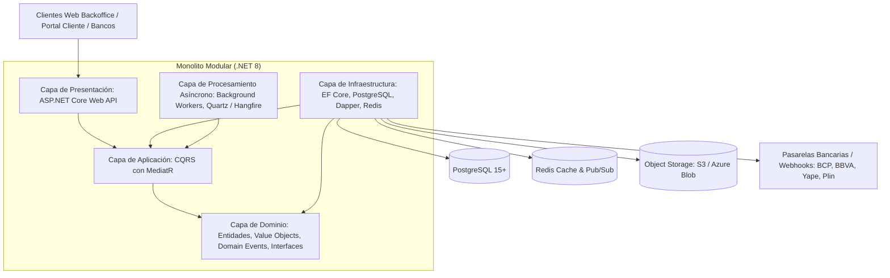
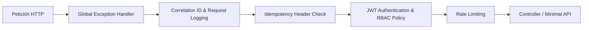

# Arquitectura Backend .NET (C#) — Sistema de Préstamos y Créditos

Este documento define la arquitectura técnica del Backend para la plataforma de gestión de créditos y préstamos, implementada sobre el ecosistema **.NET 8 / C# 12**, siguiendo el patrón arquitectónico de **Monolito Modular (Modular Monolith)** con principios de **Clean Architecture (Onion/Hexagonal)** y diseño guiado por el dominio (**Domain-Driven Design - DDD**).

---

## 1. Visión y Principios Arquitectónicos

### 1.1 ¿Por qué Monolito Modular con .NET 8?
- **Fácil mantenimiento y despliegue unificado:** Evita la sobrecarga operacional, latencia de red y complejidad de consistencia distribuida de los microservicios en etapas tempranas.
- **Fronteras estrictas entre módulos:** Cada dominio funciona como un submódulo aislado con sus propias entidades, casos de uso, eventos y repositorios. Si un módulo (ej. Integraciones o Cobranzas) necesita escalar de forma independiente en el futuro, puede desacoplarse a un microservicio sin reescribir la lógica central.
- **Alto rendimiento y concurrencia:** .NET 8 ofrece uno de los motores web más veloces del mercado (Kestrel, Minimal APIs, System.Threading.Channels, Native AOT opcional).

### 1.2 Reglas Inviolables de Implementación en .NET
1. **Precisión Financiera Absoluta:**
   - Todo monto monetario se maneja con el tipo de datos nativo `decimal` de 128 bits de C# (`System.Decimal`). Queda **terminantemente prohibido** el uso de `float` o `double`.
   - Se utiliza redondeo bancario o `MidpointRounding.AwayFromZero` (Half-Up) parametrizado a 2 decimales para importes de cuotas definitivas.
2. **Inmutabilidad Financiera:**
   - Entidades financieras críticas (`Loan`, `Schedule`, `Installment`, `Payment`, `Transaction`) no exponen setters públicos (`private set;` o `init;`).
   - Los cambios de estado se gestionan mediante métodos de negocio ricos (ej. `loan.Disburse(...)`, `installment.ApplyPayment(...)`).
3. **Control de Concurrencia y Aislamiento:**
   - Para operaciones de cobro y desembolso, se aplica **bloqueo pesimista** vía Entity Framework Core con `FromSqlRaw("SELECT ... FOR UPDATE")` o transacciones con nivel de aislamiento `IsolationLevel.ReadCommitted` / `RepeatableRead`.
4. **Idempotencia de Peticiones:**
   - Middleware de idempotencia global que intercepta cabeceras `Idempotency-Key` en operaciones mutables de dinero (`POST /api/loans`, `POST /api/loans/{id}/payments`).

---

## 2. Diagrama de la Arquitectura en Capas



---

## 3. Estructura de la Solución .NET (.sln)

```text
src/
├── Common/
│   ├── LoanSystem.Common.Domain/              # Clases base: Entity, ValueObject, AggregateRoot, IDomainEvent
│   ├── LoanSystem.Common.Application/         # Abstracciones: IQuery, ICommand, Result<T>, PaginatedList<T>
│   └── LoanSystem.Common.Infrastructure/      # Interceptores EF Core, Idempotencia, Cache Redis
│
├── Modules/
│   ├── Security/                              # Módulo 01: Autenticación, RBAC, Auditoría
│   │   ├── Domain/                            # User, RefreshToken, AuditLog
│   │   ├── Application/                       # LoginCommand, RevokeTokenCommand, Queries
│   │   └── Infrastructure/                    # JwtService, PasswordHasher, SecurityDbContext
│   │
│   ├── Customers/                             # Módulo 02: Clientes, Expediente KYC, OTP
│   │   ├── Domain/                            # Customer, CustomerDocument, OtpVerification
│   │   ├── Application/                       # RegisterCustomerCommand, VerifyKycCommand
│   │   └── Infrastructure/                    # StorageService (S3/Blob), CustomerDbContext
│   │
│   ├── Products/                              # Módulo 03: Productos, Fórmulas de Amortización
│   │   ├── Domain/                            # LoanProduct, InterestCalculator (Francés, Flat, Alemán)
│   │   ├── Application/                       # CreateProductCommand, SimulateScheduleQuery
│   │   └── Infrastructure/                    # ProductDbContext
│   │
│   ├── Origination/                           # Módulo 04: Solicitudes y Scoring DTI
│   │   ├── Domain/                            # LoanApplication, DtiEvaluationEngine
│   │   ├── Application/                       # SubmitApplicationCommand, ApproveApplicationCommand
│   │   └── Infrastructure/                    # OriginationDbContext
│   │
│   ├── Loans/                                 # Módulo 05 & 06: Desembolso, Cronogramas y Cuotas
│   │   ├── Domain/                            # Loan, Schedule, Installment, PrepaymentQuote
│   │   ├── Application/                       # DisburseLoanCommand, RestructureLoanCommand
│   │   └── Infrastructure/                    # LoanDbContext, ContractPdfGenerator (QuestPDF)
│   │
│   ├── Payments/                              # Módulo 07: Recaudación, Prelación y Libro Mayor
│   │   ├── Domain/                            # Payment, PaymentAllocation, Transaction (Ledger)
│   │   │   └── Services/PaymentCascadeEngine  # Motor de Prelación: Mora -> Interés -> Comisión -> Capital
│   │   ├── Application/                       # RegisterPaymentCommand, ReversePaymentCommand
│   │   └── Infrastructure/                    # PaymentDbContext, ReceiptsGenerator
│   │
│   ├── Treasury/                              # Módulo 08: Tesorería digital (sin cajas ni efectivo)
│   │   ├── Domain/                            # CompanyBankAccount, Disbursement, BankStatement, DailyBalance
│   │   ├── Application/                       # ConfirmDisbursementCommand, ImportBankStatementCommand, RunDailyBalanceQuery
│   │   └── Infrastructure/                    # TreasuryDbContext
│   │
│   ├── Collections/                           # Módulo 09: Mora, Aging y Promesas de Pago
│   │   ├── Domain/                            # CollectionAction, AgingReport
│   │   ├── Application/                       # RecordCollectionActionCommand, AgingQuery
│   │   └── Infrastructure/                    # CollectionsDbContext
│   │
│   └── Integrations/                          # Módulo 10: Webhooks Bancarios y Conciliación
│       ├── Domain/                            # IntegrationEvent, Reconciliation, BankAccount
│       ├── Application/                       # ProcessWebhookCommand, ReconcileStatementCommand
│       └── Infrastructure/                    # WebhookSignatureValidator (HMAC-SHA256)
│
├── WebAPI/
│   ├── LoanSystem.WebAPI/                     # Host Web: Controladores, Minimal APIs, Middlewares, DI
│   │   ├── Controllers/                       # Endpoints Backoffice y Portal Cliente
│   │   ├── Middlewares/                       # GlobalException, Idempotency, SecurityHeaders
│   │   └── Program.cs                         # Configuración de servicios y pipeline HTTP
│   │
└── BackgroundWorkers/
    ├── LoanSystem.Workers/                    # Procesos en segundo plano (Worker Service)
        ├── Jobs/DailyMoraCalculationJob.cs    # Cron 00:05 AM: Cálculo de mora diaria y paso a EN_MORA
        ├── Jobs/IntegrationRetryWorker.cs     # Worker de reintentos exponenciales para Webhooks
        └── Jobs/NotificationDispatchWorker.cs # Encolamiento de SMS/WhatsApp/Email vía Redis/RabbitMQ
```

---

## 4. Patrones de Diseño Aplicados en .NET

### 4.1 CQRS (Command Query Responsibility Segregation) con MediatR
- **Commands (Escritura):** Modifican el estado mediante transacciones seguras con Entity Framework Core.
- **Queries (Lectura):** Optimizadas con **Dapper** o proyecciones directas de EF Core (`AsNoTracking()`), garantizando latencias inferiores a 20 ms en consultas complejas (Dashboard, Reportes, Aging).

### 4.2 Motor de Prelación en Cascada (Strategy & Domain Service)
Implementado como un servicio de dominio puro en C#:
```csharp
public class PaymentCascadeEngine : IPaymentCascadeEngine
{
    public PaymentAllocationResult Allocate(Installment installment, decimal availableAmount)
    {
        decimal remaining = availableAmount;

        // 1. Mora y penalidades acumuladas
        decimal toMora = Math.Min(remaining, installment.PendingLateFee);
        remaining -= toMora;

        // 2. Intereses vencidos y corrientes
        decimal toInterest = Math.Min(remaining, installment.PendingInterest);
        remaining -= toInterest;

        // 3. Comisiones y seguros
        decimal toFee = Math.Min(remaining, installment.PendingFee);
        remaining -= toFee;

        // 4. Amortización a Capital
        decimal toPrincipal = Math.Min(remaining, installment.PendingPrincipal);
        remaining -= toPrincipal;

        return new PaymentAllocationResult(toMora, toInterest, toFee, toPrincipal, remaining);
    }
}
```

### 4.3 Generador de Cronogramas Financieros (Strategy Pattern)
Interfaz polimórfica para calcular cronogramas según el método elegido:
- `FrenchAmortizationStrategy` (Cuota fija nivelada).
- `FlatAmortizationStrategy` (Interés simple).
- `GermanAmortizationStrategy` (Amortización de capital fija).
- `AmericanAmortizationStrategy` (Intereses mensuales + capital final).

Ajuste obligatorio de centavos en la cuota final ($n$):
```csharp
decimal residualCents = loan.Principal - schedule.Installments.Sum(i => i.Principal);
schedule.Installments.Last().AdjustPrincipalResidual(residualCents);
```

---

## 5. Pipeline de Middlewares en ASP.NET Core



1. **Global Exception Handler:** Transforma excepciones de negocio en respuestas normalizadas **RFC 7807 (`ProblemDetails`)** con códigos HTTP exactos (`400`, `401`, `403`, `404`, `409`, `422`, `500`).
2. **Idempotency Middleware:**
   - Lee la cabecera `Idempotency-Key` (UUIDv4).
   - Valida en Redis o PostgreSQL si la clave ya fue ejecutada en las últimas 24 horas.
   - Si existe, devuelve de inmediato la respuesta serializada anterior con código de caché, evitando ejecuciones duplicadas de desembolsos o cobros.
3. **Auditoría Automática con EF Core Interceptors:**
   - Un `SaveChangesInterceptor` intercepta todas las inserciones, modificaciones y borrados en la base de datos, serializando el `state_before` y `state_after` en formato JSONB directamente en la tabla `audit_logs`.

---

## 6. Stack Tecnológico del Backend

| Componente | Tecnología Seleccionada | Justificación |
|---|---|---|
| **Lenguaje / Framework** | C# 12 / .NET 8 LTS | Rendimiento óptimo, tipado seguro, soporte enterprise nativo. |
| **ORM Transaccional** | Entity Framework Core 8 | Mapeo relacional, Change Tracker, migraciones controladas, interceptores. |
| **Consultas Rápidas (Read)** | Dapper | Ejecución de SQL de alta velocidad para dashboards y reportes masivos. |
| **Base de Datos** | PostgreSQL 15+ | Soporte nativo de `numeric`, `jsonb`, índices parciales y extensiones `pgcrypto`. |
| **Caché y Mensajería Local** | Redis (StackExchange.Redis) | Caché de catálogos (feriados, productos), control de tokens y llaves de idempotencia. |
| **Jobs y Tareas Programadas** | Quartz.NET / BackgroundServices | Procesamiento por lotes del cálculo de mora diaria (00:05 AM) y reintentos. |
| **Generación de PDFs** | QuestPDF | Generación ultrarrápida y tipográfica de contratos, pagarés y recibos de pago. |
| **Documentación de API** | OpenAPI 3.0 / Scalar / Swagger | Contratos de API tipados para consumo de Frontends y Bancos. |
| **Testing** | xUnit, FluentAssertions, Testcontainers | Pruebas unitarias financieras y pruebas de integración contra PostgreSQL real en Docker. |

---

## 7. Estrategia de Pruebas Automatizadas

1. **Pruebas Unitarias del Motor Financiero:**
   - Comprobación matemática exacta de cronogramas contra hojas de cálculo patrón (Excel).
   - Cuadre al milímetro de centavos: $\sum \text{Capital} = \text{Monto Desembolsado}$.
   - Pruebas de prelación: verificar que un pago de \$30 en una cuota vencida cancele primero la mora e intereses antes que el capital.
2. **Pruebas de Concurrencia (Race Conditions):**
   - Ejecución de 10 peticiones simultáneas de pago sobre un mismo préstamo para comprobar que el bloqueo pesimista en base de datos (`SELECT FOR UPDATE`) procesa una por una sin duplicar cancelaciones.
3. **Pruebas de Integración con Testcontainers:**
   - Despliegue de un contenedor efímero de PostgreSQL en memoria durante las pruebas de integración para validar las migraciones y triggers reales.
