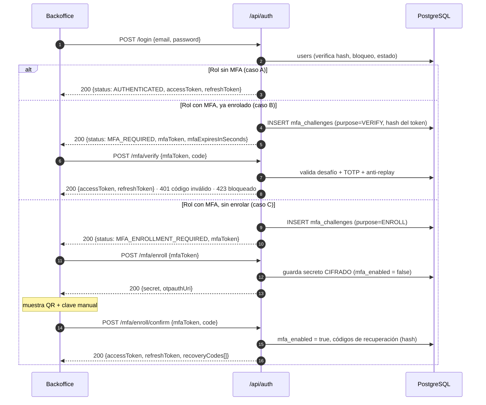

# Análisis — BE-SEC-03: MFA (TOTP) obligatorio para `ROLE_ADMIN` y `ROLE_OPERATOR`

> Documento de **análisis previo**: no implementa código. Revisa el requisito, el estado actual del backend, la BD y
> el frontend, propone un diseño coherente con la Arquitectura Hexagonal del módulo `Security` y deja listadas las
> decisiones que hay que tomar antes de escribir el plan de implementación.
>
> Fecha: 2026-11-13 · Relacionado: [`PLAN_01_SECURITY.md`](PLAN_01_SECURITY.md) §8,
> [`PLAN_02_EMAIL_VERIFICATION_Y_RESET.md`](PLAN_02_EMAIL_VERIFICATION_Y_RESET.md).

---

## 1. Resumen

- **Qué pide el requisito:** los usuarios con roles que mueven dinero (`ROLE_ADMIN`, `ROLE_OPERATOR`) deben presentar,
  además de la contraseña, un código TOTP de 6 dígitos de una app autenticadora (Google Authenticator, Microsoft
  Authenticator, Authy, etc.).
- **Estado hoy:** no existe nada en backend ni en BD. El frontend del backoffice tiene una pantalla
  `TotpPage.vue` que es un **placeholder** a la espera del contrato.
- **Propuesta:** login en **dos pasos**. Si la contraseña es correcta y el rol exige MFA, `POST /api/auth/login` no
  emite tokens; devuelve un **desafío** de corta duración (`mfaToken`). Los tokens solo se emiten tras
  `POST /api/auth/mfa/verify`. Si el usuario aún no tiene MFA configurado, el desafío lo lleva a un **enrolamiento
  obligatorio** (QR + confirmación con un código).
- **Tamaño:** 1 migración SQL, 2 entidades nuevas + cambios en `User`, 4 casos de uso nuevos + cambio en
  `LoginUseCase`, 2 adaptadores (TOTP y cifrado), 4 endpoints nuevos y cambios en el frontend.

---

## 2. Requisito y fuentes

| Fuente | Texto |
|---|---|
| [`REQUERIMIENTOS_BACKEND.md`](../../docs/REQUERIMIENTOS_BACKEND.md) — **BE-SEC-03** | MFA (TOTP) obligatorio para `ROLE_ADMIN` y `ROLE_OPERATOR` · MVP · Nuevo |
| [`REQUERIMIENTOS_BDD.md`](../../docs/REQUERIMIENTOS_BDD.md) — **DB-18** | `users`: secreto TOTP **cifrado** y bandera de MFA activo · MVP · Falta |
| [`REQUERIMIENTOS_FRONTEND.md`](../../docs/REQUERIMIENTOS_FRONTEND.md) — **FE-BO-02** | Segundo factor (TOTP) obligatorio para Admin y Operador · marcado "Implementado" (en realidad es placeholder, ver §3.3) |
| [`ARQUITECTURA_GENERAL.md`](../../ARQUITECTURA_GENERAL.md) §9 | Backoffice: correo + contraseña + **MFA obligatorio (TOTP)** para los roles que mueven dinero |
| `AddUserDialog.vue` (backoffice) | "El usuario deberá … registrar su autenticación en dos pasos (TOTP) **al iniciar sesión**" → el enrolamiento es en el primer login |

**Fuera de alcance:** el OTP por SMS/WhatsApp del portal del cliente (`ROLE_CLIENT`) es otro requisito (pendiente
P9 `otp_verifications` en `ARQUITECTURA_GENERAL` §14) y no se mezcla con este.

---

## 3. Estado actual

### 3.1 Backend (módulo `Security`)

| Pieza | Situación | Impacto del MFA |
|---|---|---|
| [`LoginUseCase.cs`](../src/Modules/Security/LoanSystem.Modules.Security.Core/Application/LoginUseCase.cs) | Contraseña OK → `RecordSuccessfulLogin` (resetea el contador de fallos) → `TokenIssuer.Issue` → tokens | Debe bifurcarse **antes** de resetear el contador y de emitir tokens (ver §7.1) |
| [`TokenIssuer.cs`](../src/Modules/Security/LoanSystem.Modules.Security.Core/Application/TokenIssuer.cs) | Emite JWT + refresh token | Se reutiliza tal cual desde el paso de verificación MFA |
| [`AuthContracts.cs`](../src/Modules/Security/LoanSystem.Modules.Security.Core/Contracts/AuthContracts.cs) | `AuthTokensResponse` es la respuesta de login | Login necesita una respuesta que pueda ser "tokens" **o** "desafío" (ver §6.1, D1) |
| [`User.cs`](../src/Modules/Security/LoanSystem.Modules.Security.Core/Domain/User.cs) | Sin campos de MFA | Añadir estado de MFA y métodos de dominio |
| [`RefreshTokenUseCase.cs`](../src/Modules/Security/LoanSystem.Modules.Security.Core/Application/RefreshTokenUseCase.cs) | Rota refresh tokens sin volver a pedir factores | Correcto: los refresh tokens solo se emitirán tras completar el MFA. Ver §8 (sesiones previas al despliegue) |
| [`SecurityModule.cs`](../src/Modules/Security/LoanSystem.Modules.Security.Adapters/SecurityModule.cs) | Lee `Security:*` de configuración y registra casos de uso | Añadir sección `Security:Mfa` y nuevos registros |
| [`AuditLogInterceptor.cs`](../src/Common/LoanSystem.Common.Adapters/Persistence/AuditLogInterceptor.cs) | Redacta propiedades sensibles: lista fija + **cualquier nombre que contenga `secret`** | Nombrar la propiedad `MfaSecretEncrypted` hace que se redacte sola. Los hashes de códigos de recuperación **no** quedarían cubiertos → excluir esa tabla de la auditoría |
| `Program.cs` | JWT HS256, `FallbackPolicy` = usuario autenticado, **sin rate limiting** | Los endpoints MFA son `AllowAnonymous` (el `mfaToken` es la credencial). Se recomienda rate limiting (§8) |
| [`Directory.Packages.props`](../Directory.Packages.props) | Solo `BCrypt.Net-Next` en seguridad | Añadir librería TOTP (D4) |

### 3.2 Base de datos

[`02_security_users.sql`](../../database/migrations/02_security_users.sql): la tabla `users` no tiene columnas de MFA
(confirma DB-18 "Falta"). La última migración es `15_audit_logs_append_only.sql` → la nueva será la **16**.

### 3.3 Frontend (backoffice Vue)

| Archivo | Situación |
|---|---|
| `frontend/apps/backoffice/src/features/auth/pages/TotpPage.vue` | Placeholder explícito ("se conecta al backend cuando defina el contrato TOTP"). Simula un `await` y muestra un toast. Tiene un contador de 30 s que **no tiene sentido** para TOTP (la ventana la marca la app del usuario) |
| `frontend/apps/backoffice/src/features/auth/routes.ts` | Ruta pública `/verificacion-dos-pasos` (`name: 'totp'`) ya existe |
| `frontend/apps/backoffice/src/app/stores/session.ts` | `login()` asume que la respuesta trae `accessToken` directamente; nunca navega a `totp` |
| `frontend/packages/api-client/src/contracts.ts` | `TokenResponse { accessToken }`; no hay tipos de MFA |
| `frontend/packages/mocks/src/handlers/auth.ts` | Los mocks no simulan MFA |
| — | **No existe** pantalla de enrolamiento (QR + confirmación) |

> ⚠️ **Desalineación previa, ajena al MFA pero que afecta al flujo completo:** el frontend asume que el refresh
> token viaja en una **cookie HttpOnly** (`session.ts`, `withCredentials: true`, `/auth/refresh` con body `null`),
> mientras que el backend lo devuelve en el **body** y lo espera en el body de `/refresh` y `/logout`. Hay que
> resolverlo para que el login con MFA funcione de punta a punta (ver Q7).

---

## 4. Flujo propuesto

Tres casos según el rol y si el usuario ya configuró MFA:

| Caso | Condición | Respuesta de `POST /api/auth/login` |
|---|---|---|
| **A** | Rol **sin** MFA obligatorio (Analyst, Collector, Auditor, Client) | Igual que hoy: tokens (`status: AUTHENTICATED`) |
| **B** | Rol con MFA y **ya enrolado** | `status: MFA_REQUIRED` + `mfaToken` → el cliente llama a `/mfa/verify` |
| **C** | Rol con MFA y **sin enrolar** (primer login) | `status: MFA_ENROLLMENT_REQUIRED` + `mfaToken` → `/mfa/enroll` → `/mfa/enroll/confirm` |



---

## 5. Modelo de datos (borrador de `16_users_mfa.sql`)

SQL-First con DbUp, igual que el resto del esquema (no migraciones EF).

```sql
-- 1) Estado de MFA en users (DB-18)
ALTER TABLE users
    ADD COLUMN mfa_enabled          BOOLEAN     NOT NULL DEFAULT FALSE,
    ADD COLUMN mfa_secret_encrypted TEXT,           -- secreto TOTP cifrado (AES-GCM). Nunca en claro.
    ADD COLUMN mfa_enrolled_at      TIMESTAMPTZ,
    ADD COLUMN mfa_last_used_step   BIGINT;         -- anti-replay: último paso TOTP aceptado

ALTER TABLE users ADD CONSTRAINT ck_users_mfa_secret
    CHECK (NOT mfa_enabled OR mfa_secret_encrypted IS NOT NULL);

-- 2) Desafíos del segundo paso del login (un solo uso, corta duración)
CREATE TABLE mfa_challenges (
    id          UUID         PRIMARY KEY DEFAULT gen_random_uuid(),
    user_id     UUID         NOT NULL REFERENCES users(id) ON DELETE CASCADE,
    token_hash  VARCHAR(255) NOT NULL UNIQUE,      -- SHA-256 del mfaToken (como refresh_tokens)
    purpose     VARCHAR(20)  NOT NULL CHECK (purpose IN ('VERIFY', 'ENROLL')),
    attempts    SMALLINT     NOT NULL DEFAULT 0,
    expires_at  TIMESTAMPTZ  NOT NULL,
    consumed_at TIMESTAMPTZ,                       -- NULL = aún utilizable
    user_ip     INET,
    user_agent  TEXT,
    created_at  TIMESTAMPTZ  NOT NULL DEFAULT NOW()
);

-- 3) Códigos de recuperación (solo si se aprueba D6)
CREATE TABLE mfa_recovery_codes (
    id         UUID         PRIMARY KEY DEFAULT gen_random_uuid(),
    user_id    UUID         NOT NULL REFERENCES users(id) ON DELETE CASCADE,
    code_hash  VARCHAR(255) NOT NULL,
    used_at    TIMESTAMPTZ,
    created_at TIMESTAMPTZ  NOT NULL DEFAULT NOW()
);
CREATE INDEX ix_mfa_recovery_codes_user_unused ON mfa_recovery_codes (user_id) WHERE used_at IS NULL;

-- 4) Las sesiones abiertas sin MFA de los roles afectados dejan de ser válidas (ver §8)
UPDATE refresh_tokens SET revoked_at = NOW()
 WHERE revoked_at IS NULL
   AND user_id IN (SELECT id FROM users WHERE role IN ('ROLE_ADMIN', 'ROLE_OPERATOR'));
```

> Se usa el patrón de `refresh_tokens`: se guarda solo el **hash** del token y se revoca, nunca se borra.
> `mfa_challenges` y `mfa_recovery_codes` se excluyen de la auditoría con `ExcludeFromAudit()`, que es el mismo
> criterio que ya se aplica a `refresh_tokens`.

---

## 6. Diseño por capas

### 6.1 Contratos (`Security.Core/Contracts`)

```csharp
// Respuesta de login: cambio ADITIVO. Para roles sin MFA los campos de token siguen arriba como hoy.
public sealed record LoginResponse(
    string Status,                 // "AUTHENTICATED" | "MFA_REQUIRED" | "MFA_ENROLLMENT_REQUIRED"
    string? AccessToken, string? RefreshToken, int? ExpiresInSeconds, string? Role,
    string? MfaToken, int? MfaExpiresInSeconds);

public sealed record MfaVerifyRequest(string MfaToken, string? Code, string? RecoveryCode);
public sealed record MfaEnrollRequest(string MfaToken);
public sealed record MfaEnrollResponse(string Secret, string OtpauthUri);   // el QR lo dibuja el frontend (D5)
public sealed record MfaEnrollConfirmRequest(string MfaToken, string Code);
public sealed record MfaEnrollConfirmResponse(AuthTokensResponse Tokens, IReadOnlyList<string> RecoveryCodes);
public sealed record ResetUserMfaRequest(Guid UserId);
```

### 6.2 Endpoints (`SecurityEndpoints`)

| Método + ruta | Caso de uso | Autorización | Respuestas |
|---|---|---|---|
| `POST /api/auth/login` *(modificado)* | `ILoginUseCase` | `AllowAnonymous` | 200 `LoginResponse` · 401 · 403 · 423 |
| `POST /api/auth/mfa/verify` | `IVerifyMfaUseCase` | `AllowAnonymous` (credencial = `mfaToken`) | 200 tokens · 401 código o desafío inválido · 423 bloqueado |
| `POST /api/auth/mfa/enroll` | `IBeginMfaEnrollmentUseCase` | `AllowAnonymous` (`mfaToken` con `purpose=ENROLL`) | 200 `{secret, otpauthUri}` · 401 |
| `POST /api/auth/mfa/enroll/confirm` | `IConfirmMfaEnrollmentUseCase` | `AllowAnonymous` (`mfaToken` con `purpose=ENROLL`) | 200 tokens + códigos de recuperación · 401 · 423 |
| `POST /api/users/{id}/mfa/reset` | `IResetUserMfaUseCase` | `ROLE_ADMIN` | 204 · 404 · 409 si se resetea a sí mismo (Q2) |

`GET /api/me` puede exponer además `mfaEnabled` para que el frontend lo muestre en el perfil (opcional).

### 6.3 Dominio (`Security.Core/Domain`)

- **`User`** (nuevas propiedades `MfaEnabled`, `MfaSecretEncrypted`, `MfaEnrolledAt`, `MfaLastUsedStep`):
  - `RequiresMfa(IReadOnlySet<SecurityRole> requiredRoles)`
  - `StartMfaEnrollment(string encryptedSecret)` → solo si `!MfaEnabled`; reemplaza un secreto pendiente anterior.
  - `CompleteMfaEnrollment(IClock clock, long step)` → `MfaEnabled = true`, `MfaEnrolledAt`, `MfaLastUsedStep = step`.
  - `TryAcceptMfaStep(long step)` → `false` si `step <= MfaLastUsedStep` (**anti-replay**); si no, lo guarda.
  - `ResetMfa()` → limpia secreto, bandera y paso.
- **`MfaChallenge : Entity<Guid>`** → `Issue(...)`, `IsActive(IClock)`, `RegisterFailedAttempt(int max)` (devuelve
  si se agotó), `Consume(IClock)`.
- **`MfaChallengePurpose`** = `VERIFY | ENROLL`.
- **`MfaRecoveryCode : Entity<Guid>`** → `Use(IClock)` (si se aprueba D6).

### 6.4 Puertos de salida (`Security.Core/Ports/Outbound`)

```csharp
public interface ITotpService
{
    string GenerateSecret();                                        // Base32, 160 bits
    string BuildProvisioningUri(string secret, string accountName); // otpauth://totp/LoanSystem:{email}?secret=…&issuer=LoanSystem
    bool TryVerify(string secret, string code, DateTimeOffset now, out long matchedStep); // ventana ±1 paso
}
public interface ISecretProtector { string Protect(string plaintext); string Unprotect(string protectedValue); }
public interface IMfaChallengeRepository { void Add(MfaChallenge c); Task<MfaChallenge?> FindByHashAsync(string hash, CancellationToken ct); }
public interface IMfaRecoveryCodeRepository { void AddRange(IEnumerable<MfaRecoveryCode> codes); Task<IReadOnlyList<MfaRecoveryCode>> FindUnusedAsync(Guid userId, CancellationToken ct); }
```

`now` sale de `IClock`. Así las pruebas son deterministas y `Core` no depende de ninguna librería.

### 6.5 Casos de uso (`Security.Core/Application`)

- **`LoginUseCase`** (modificado):
  - Tras validar contraseña, bloqueo y estado: si `RequiresMfa` → crear `MfaChallenge` (`VERIFY` si ya está
    enrolado, `ENROLL` si no) y devolver el desafío.
  - **No** llamar a `RecordSuccessfulLogin` en ese punto (ver §8, fuerza bruta).
- **`VerifyMfaUseCase`**:
  1. Busca el desafío por hash y comprueba que esté activo y sea de tipo `VERIFY`.
  2. Comprueba el usuario: activo y no bloqueado.
  3. Descifra el secreto, ejecuta `TryVerify` y luego `TryAcceptMfaStep`.
  4. Si falla: `challenge.RegisterFailedAttempt` + `user.RegisterFailedLogin` + auditoría `MFA_FAILED` → 401, o 423
     si se bloquea la cuenta.
  5. Si acierta: `Consume`, `RecordSuccessfulLogin`, auditoría `LOGIN` y `TokenIssuer.Issue`.

  Acepta `RecoveryCode` como alternativa a `Code`.
- **`BeginMfaEnrollmentUseCase`**: desafío `ENROLL` válido → `GenerateSecret` → `Protect` → `StartMfaEnrollment` →
  devuelve el secreto y el URI. Es idempotente dentro del mismo desafío.
- **`ConfirmMfaEnrollmentUseCase`**:
  - Verifica el código contra el secreto pendiente y llama a `CompleteMfaEnrollment`.
  - Genera 10 códigos de recuperación y guarda solo su hash.
  - Auditoría `MFA_ENROLLED`; después consume el desafío y emite los tokens.
- **`ResetUserMfaUseCase`** (admin): `ResetMfa()` + `RevokeAllForUserAsync` + auditoría `MFA_RESET`. Todo en una
  transacción, igual que `SuspendUserUseCase`.

### 6.6 Adaptadores (`Security.Adapters/Outbound`)

- **`OtpNetTotpService : ITotpService`** — sobre la librería elegida en D4 (SHA-1, 6 dígitos, paso de 30 s, que son
  los valores por defecto que entienden todas las apps).
- **`AesGcmSecretProtector : ISecretProtector`** — `System.Security.Cryptography.AesGcm` (sin paquete extra). La
  clave de 256 bits viene de `Security:Mfa:EncryptionKey` (gestor de secretos, nunca en el repo). El formato guardado
  lleva versión (`v1:<base64(nonce|ciphertext|tag)>`) para poder rotar la clave.
- **`MfaChallengeRepository`**, **`MfaRecoveryCodeRepository`**, y el mapeo en `SecurityDbContext` (columnas
  snake_case, `ExcludeFromAudit()` en las dos tablas nuevas).

### 6.7 Configuración

```json
"Security": {
  "Mfa": {
    "RequiredRoles": [ "ROLE_ADMIN", "ROLE_OPERATOR" ],
    "Issuer": "LoanSystem",
    "ChallengeMinutes": 5,
    "EnrollmentChallengeMinutes": 10,
    "MaxAttemptsPerChallenge": 5,
    "AllowedDriftSteps": 1
  }
}
```

`Security:Mfa:EncryptionKey` va **solo** en user-secrets (dev) o en variables de entorno / gestor de secretos
(prod), igual que `Jwt:Key`. Conviene aprovechar para crear `SecurityOptions` con `IOptions<T>`, que ya está
pendiente en el TODO #5 de `LoginUseCase`.

---

## 7. Decisiones técnicas (alternativas y recomendación)

| # | Decisión | Opciones | Recomendación |
|---|---|---|---|
| **D1** | Forma de la respuesta de login con MFA | (a) `200` con `status` discriminado · (b) `401` ProblemDetails con código `Security.MfaRequired` y el `mfaToken` como extensión | **(a)**: la contraseña **sí** fue correcta, así que 401 sería semánticamente falso. Además el cambio es aditivo: para roles sin MFA la respuesta conserva `accessToken`/`refreshToken` arriba |
| **D2** | Dónde vive el desafío | (a) Tabla `mfa_challenges` · (b) JWT firmado con `purpose=mfa` · (c) `IMemoryCache`/Redis | **(a)**: permite un solo uso, contar intentos y funciona con varias instancias. Repite el patrón de `refresh_tokens`. (b) no permite contar intentos ni invalidar; (c) pierde estado con un reinicio y en memoria no se comparte |
| **D3** | Cómo se protege el secreto TOTP (debe poder **descifrarse**, no basta con un hash) | (a) AES-GCM con clave en el gestor de secretos · (b) ASP.NET Core Data Protection | **(a)**: es explícito, testeable y sin dependencias. (b) exige persistir y compartir el *key ring* (Redis o filesystem) y añade paquetes. Encaja con BE-SEC-10 (secretos en el gestor) |
| **D4** | Librería TOTP | (a) **Otp.NET** (MIT, ampliamente usada) · (b) implementación propia RFC 6238 (~40 líneas de HMAC) | **(a)** detrás de `ITotpService`: menos riesgo de errores sutiles. Cambiarla después solo afecta al adaptador |
| **D5** | Quién genera el QR | (a) Frontend, a partir de `otpauthUri` · (b) Backend devuelve PNG (p. ej. QRCoder) | **(a)**: el backend no añade dependencias de imagen. El frontend necesita una librería QR pequeña |
| **D6** | Recuperación si el usuario pierde el teléfono | (a) Solo reset por un admin · (b) Reset por admin **+** 10 códigos de recuperación de un solo uso | **(b)**: sin códigos, si el único admin pierde el teléfono nadie puede entrar. Si se quiere recortar el MVP, (a) y los códigos en una fase posterior |

---

## 8. Riesgos de seguridad y cómo se cubren

| Riesgo | Mitigación en el diseño |
|---|---|
| **Fuerza bruta del código** (10⁶ combinaciones, 3 válidas con la ventana ±1) | Máx. 5 intentos por desafío, y cada fallo de MFA suma al **mismo** contador de `RegisterFailedLogin` → bloqueo `423` tras 5 fallos en 15 min (BE-SEC-02) |
| **Reinicio del contador con la contraseña** | Hoy, una contraseña correcta resetea el contador (`RecordSuccessfulLogin`). Si se mantiene así con MFA, quien tenga la contraseña podría repetir login → 5 intentos → login… sin límite. **Para roles con MFA el reset se mueve al éxito del segundo factor** |
| **Reutilización de un código** (replay dentro de sus ~90 s) | `mfa_last_used_step`: no se acepta un paso igual o anterior al último usado |
| **Secreto filtrado desde BD, logs o auditoría** | Cifrado AES-GCM con la clave fuera de la BD. `AuditLogInterceptor` redacta cualquier propiedad que contenga `secret`. Nunca se loguea el secreto ni el código |
| **`mfaToken` robado** | Vida de 5 min, un solo uso, solo se guarda el hash, ligado a IP y user-agent (para auditar). Por sí solo no da acceso: sigue haciendo falta el código |
| **Enrolamiento secuestrado** (quien conoce la contraseña de una cuenta sin enrolar registra **su** app) | Es inherente al "enrolamiento en el primer login". Se mitiga con la invitación por correo y contraseña inicial de un solo uso (PLAN_02), con la auditoría `MFA_ENROLLED` (IP y user-agent) y con el reset por admin |
| **Sesiones abiertas antes del despliegue** | Los refresh tokens vigentes de Admin/Operador se obtuvieron sin MFA → la migración 16 los **revoca** (§5, paso 4) |
| **Usuario promovido a Admin/Operador con sesión abierta** | Al cambiar de rol hay que revocar sus sesiones (encaja con BE-SEC-09, cambios de rol). Se deja anotado |
| **Access token vigente tras un reset de MFA** | El reset revoca los refresh tokens, pero el JWT sigue válido hasta su expiración (≤ 30 min). Riesgo aceptado, igual que hoy con logout |
| **Desfase de reloj** | Ventana ±1 paso (±30 s). El servidor debe tener NTP |
| **Sin rate limiting en `/api/auth/*`** | Recomendado: `AddRateLimiter` nativo de ASP.NET Core (sin paquete) por IP en login y MFA. Puede hacerse en esta tarea o aparte |
| **Endpoints que mueven dinero sin exigir MFA explícito** | Opcional (defensa en profundidad): claim `amr: ["pwd","otp"]` en el JWT y una política `RequireMfa` para esos endpoints |

---

## 9. Impacto en el frontend (backoffice)

1. **`contracts.ts`**: tipos `LoginResponse` (con `status`), `MfaVerifyRequest`, `MfaEnrollResponse`, etc.
2. **`session.ts`**: `login()` debe bifurcar según `status`. El `mfaToken` se guarda **solo en memoria** y se navega a
   `totp` o a la nueva ruta de enrolamiento.
3. **`TotpPage.vue`**:
   - Conectar a `POST /auth/mfa/verify`.
   - Quitar el aviso de placeholder y el contador de 30 s (lo que expira es el desafío, a los 5 min).
   - Manejar `401` (código incorrecto) y `423` (reutilizar la pantalla de cuenta bloqueada).
   - Ofrecer la opción "usar un código de recuperación".
4. **Pantalla nueva de enrolamiento**:
   - QR desde `otpauthUri` (librería QR) y clave manual para copiar.
   - Campo para el primer código.
   - Mostrar **una sola vez** los códigos de recuperación, con opción de descargarlos o copiarlos.
5. **Usuarios (admin)**: acción "Restablecer MFA".
6. **Mocks (`handlers/auth.ts`)**: simular MFA para Admin/Operador (código demo fijo, como ya hace el OTP del
   portal).
7. **`REQUERIMIENTOS_FRONTEND.md`**: FE-BO-02 figura como "Implementado" pero es un placeholder; corregir el estado.

---

## 10. Pruebas

| Suite | Casos |
|---|---|
| **Domain.UnitTests** | `TryAcceptMfaStep` rechaza un paso igual o anterior · `CompleteMfaEnrollment` activa la bandera · `ResetMfa` limpia el estado · `MfaChallenge`: expiración, un solo uso, agotamiento de intentos |
| **Application.UnitTests** | Login de Analyst → tokens directos · login de Admin enrolado → `MFA_REQUIRED` **sin** tokens y **sin** resetear el contador · Admin sin enrolar → `MFA_ENROLLMENT_REQUIRED` · verify OK → tokens + `LastLoginAt` · código malo → 401 y suma al contador · 5.º fallo → 423 · replay del mismo código → 401 · desafío expirado o consumido → 401 · `ENROLL` usado en `/verify` → 401 · código de recuperación de un solo uso · reset por admin revoca sesiones |
| **Adapters.UnitTests** | `OtpNetTotpService` con los **vectores de prueba de RFC 6238** · `AesGcmSecretProtector`: ida y vuelta, y falla si se altera el texto cifrado · el interceptor redacta `MfaSecretEncrypted` |
| **IntegrationTests** (Testcontainers) | La migración 16 se aplica · flujo completo `login → enroll → confirm → /api/me` · `login → verify → refresh → logout` · se revocan los refresh tokens previos de Admin/Operador |
| **Architecture.Tests** | `Security.Core` sigue sin depender de librerías de infraestructura (Otp.NET solo en Adapters) |

---

## 11. Orden de trabajo propuesto

1. **BD + dominio**: migración `16_users_mfa.sql`, cambios en `User`, `MfaChallenge`, pruebas de dominio.
2. **Adaptadores**: TOTP, cifrado AES-GCM, repositorios, mapeo EF, `Security:Mfa` + `SecurityOptions`.
3. **Casos de uso + endpoints**: cambio en `LoginUseCase`, verify, enroll, confirm, reset; pruebas de aplicación.
4. **Integración**: pruebas con Testcontainers del flujo completo.
5. **Frontend**: contratos, `session.ts`, `TotpPage`, pantalla de enrolamiento, mocks.
6. **Documentación**: `PLAN_01_SECURITY.md` §8, estados de BE-SEC-03 / DB-18 / FE-BO-02.

Los pasos 1–4 son independientes del frontend. El 5 puede empezar en paralelo con mocks en cuanto se aprueben los
contratos de §6.1.

---

## 12. Preguntas abiertas (decidir antes del plan de implementación)

| # | Pregunta | Propuesta por defecto |
|---|---|---|
| **Q1** | ¿Códigos de recuperación en el MVP o solo reset por admin? (D6) | Ambos |
| **Q2** | ¿Un admin puede resetear su **propio** MFA? | No: debe hacerlo otro admin (anticipa los cuatro ojos de BE-SEC-09) |
| **Q3** | ¿Solo Admin y Operador, o también Analyst (aprueba créditos)? | Solo los dos del requisito, configurable por `RequiredRoles` |
| **Q4** | ¿Dónde vive `Security:Mfa:EncryptionKey` en producción? | El mismo gestor de secretos previsto para BE-SEC-10 |
| **Q5** | ¿"Recordar este dispositivo" durante N días? | No en el MVP (es más superficie de ataque) |
| **Q6** | ¿Incluir rate limiting de `/api/auth/*` en esta tarea? | Sí, es poco código y protege login y MFA |
| **Q7** | ¿Se alinea ya el refresh token como cookie HttpOnly (lo que espera el frontend) o se adapta el frontend al body? | Decidir antes del paso 5; afecta a todo el login, no solo al MFA |
