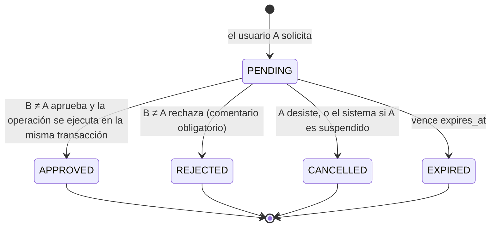
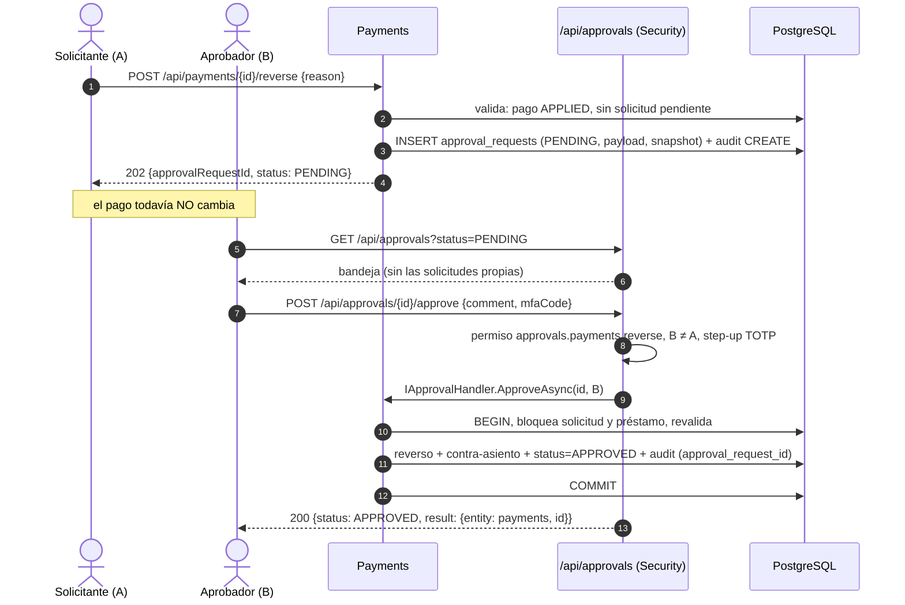

# Análisis — BE-SEC-09: Cuatro ojos (reversos, castigos, ajustes, cambios de tasa y de rol)

> Documento de **análisis previo**: no implementa código. Revisa el requisito, el estado actual del backend, la BD y
> el frontend, propone un diseño coherente con la Arquitectura Hexagonal y el monolito modular, y deja listadas las
> decisiones que hay que tomar antes de escribir el plan de implementación.
>
> Fecha: 2026-11-13 · Relacionado: [`PLAN_01_SECURITY.md`](PLAN_01_SECURITY.md) §8,
> [`ANALISIS_03_MFA_TOTP.md`](ANALISIS_03_MFA_TOTP.md) (step-up con TOTP, revocación de sesiones al cambiar de rol).

---

## 1. Resumen

- **Qué pide el requisito:** las operaciones sensibles (reversos, castigos, ajustes manuales, cambios de tasa y
  cambios de rol) no se ejecutan con la acción de una sola persona. Un usuario las **solicita** y otro usuario
  **distinto**, autenticado por su cuenta, las **aprueba**. Solo entonces se ejecutan.
- **Estado hoy:**
  - No existe modelo de aprobaciones ni en backend ni en BD (DB-66 "Falta").
  - Tampoco existen todavía las operaciones a proteger: Payments, Loans, Products y Collections solo exponen `/ping`.
  - En el frontend, el castigo "con segundo aprobador" (FE-BO-35) es **declarativo**: el solicitante elige un nombre
    de una lista y nadie más interviene (ver §3.3).
- **Propuesta:**
  - Un **motor de aprobaciones común**: tabla `approval_requests` y agregado `ApprovalRequest` en `Common.Core`, más
    una **bandeja única** `/api/approvals`.
  - Los endpoints de cada operación dejan de ejecutar y pasan a **crear una solicitud** (`202 Accepted`).
  - Al aprobar, el **módulo dueño** ejecuta la operación y marca la solicitud como aprobada **en la misma
    transacción**.
  - La regla "aprobador ≠ solicitante" se valida en el dominio **y** con un `CHECK` en la BD.
- **Tamaño:**
  - Núcleo: 1 migración (17), 1 agregado común con su mapeo EF, 2 puertos comunes, 5 casos de uso genéricos en
    Security, 5 endpoints, 1 job de expiración y un cambio pequeño en el interceptor de auditoría.
  - Por operación: 1 caso de uso de solicitud + 1 *handler* de aprobación. Hoy solo se puede construir el cambio de
    rol. El resto se conecta cuando exista su módulo (ver §11).

---

## 2. Requisito y fuentes

| Fuente | Texto |
|---|---|
| [`REQUERIMIENTOS_BACKEND.md`](../../docs/REQUERIMIENTOS_BACKEND.md) — **BE-SEC-09** | Reversos, castigos, ajustes manuales, cambios de tasa y cambios de rol requieren la aprobación de un segundo usuario distinto del solicitante · F2 · Parcial (sin modelo de aprobaciones) |
| [`REQUERIMIENTOS_BDD.md`](../../docs/REQUERIMIENTOS_BDD.md) — **DB-66** | Tabla de aprobaciones de 4 ojos (operación, solicitante, aprobador distinto, estado y motivo) · F2 · Falta |
| [`13-administracion-y-configuracion.md`](../../docs/13-administracion-y-configuracion.md) — **RNF-26** | Ningún usuario puede auto-aprobarse permisos o cambiar su propio rol administrativo sin la intervención de otro administrador |
| [`07-mora-y-cobranzas.md`](../../docs/07-mora-y-cobranzas.md) — **RF-22.2** | Castigo: préstamo `EN_MORA` con atraso significativo, aprobación explícita con **acta de comité** y justificación obligatoria |
| [`10-refinanciamiento-y-reestructuracion.md`](../../docs/10-refinanciamiento-y-reestructuracion.md) — **RNF-20** | Toda reestructuración o refinanciamiento registra un dictamen formal del comité o jefe de créditos en el `AuditLog` |
| [`06-pagos-y-cobros.md`](../../docs/06-pagos-y-cobros.md) — **RF-18.2/18.3** | `POST /api/payments/{id}/reverse`, motivo obligatorio, permiso `payments.reverse` ("Supervisor / Admin") |
| [`ARQUITECTURA_GENERAL.md`](../../ARQUITECTURA_GENERAL.md) §9 | Cuatro ojos: reversos, castigos, ajustes manuales y cambios de tasa. **No** menciona el cambio de rol, que sí está en BE-SEC-09 y RNF-26 |
| Requisitos que **reutilizarán** el motor | BE-COL-08 (castigo), BE-LOA-14 (dictamen de reestructuración), BE-COL-10 (condonaciones con 4 ojos, V2), FE-BO-35, FE-BO-47 |

**Fuera de alcance:**

- La colusión entre dos personas (los cuatro ojos no la impiden; se detecta con auditoría, ver §9).
- La firma mancomunada del cliente (US-55).
- El flujo de evaluación de solicitudes de crédito: el analista aprueba créditos con sus propias reglas, no con
  esta regla.

---

## 3. Estado actual

### 3.1 Backend

| Pieza | Situación | Impacto |
|---|---|---|
| `PaymentsEndpoints`, `LoansEndpoints`, `CollectionsEndpoints` | Solo `/ping`. No hay reverso, castigo, ajustes ni reestructuración | El motor se diseña antes que las operaciones. Cada operación debe **nacer** como "solicitud" (ver Q8) |
| [`ProductsEndpoints.cs`](../src/Modules/Products/LoanSystem.Modules.Products.Adapters/Inbound/Http/ProductsEndpoints.cs) | Solo `/simulate`. No hay alta ni edición de productos | El cambio de tasa se define junto con la edición de productos |
| [`SecurityEndpoints.cs`](../src/Modules/Security/LoanSystem.Modules.Security.Adapters/Inbound/Http/SecurityEndpoints.cs) | Suspender, activar y resetear MFA. **No** hay alta de usuarios ni cambio de rol | El cambio de rol es la **primera** operación que se puede construir de punta a punta |
| [`RolePermissions.cs`](../src/Modules/Security/LoanSystem.Modules.Security.Core/Domain/RolePermissions.cs) | Mapa estático rol → permisos. `payments.reverse`, `products.manage` y `admin.manage` solo los tiene `ROLE_ADMIN`. No existe rol Supervisor | Con la matriz actual, solicitante y aprobador serían ambos Admin, así que hacen falta **al menos 2 admins activos** (Q1, Q9) |
| `Program.cs` | Políticas por **rol** (`RequireRole`), `FallbackPolicy` = autenticado | El permiso de aprobar depende de la operación, que solo se conoce al cargar la solicitud → se comprueba en el caso de uso (ver §6.5) |
| [`SuspendUserUseCase.cs`](../src/Modules/Security/LoanSystem.Modules.Security.Core/Application/SuspendUserUseCase.cs) | Ya impide auto-suspenderse (`Security.CannotSuspendSelf`) | Precedente de "no sobre uno mismo". Además, al suspender habrá que cancelar las solicitudes pendientes del usuario (§9) |
| [`AuditLogInterceptor.cs`](../src/Common/LoanSystem.Common.Adapters/Persistence/AuditLogInterceptor.cs) | Una **única** acción de negocio por `SaveChanges` para todas las entidades. El actor es el usuario autenticado | Al aprobar se modifican la solicitud (`APPROVE`) y el objetivo (`REVERSE`, `WRITE_OFF`…) en el mismo `SaveChanges`. Hace falta una acción por entidad y enlazar los registros con la solicitud (D7) |
| [`ModuleDbContext.cs`](../src/Common/LoanSystem.Common.Adapters/Persistence/ModuleDbContext.cs) | Todos los módulos mapean `outbox_messages` y `audit_logs` | **Precedente** de tabla compartida mapeada por cada módulo. `approval_requests` sigue el mismo patrón (D3) |
| [`ArchitectureTests.cs`](../tests/LoanSystem.Architecture.Tests/ArchitectureTests.cs) | Un módulo solo puede ver `Core.Contracts` de otro; `Common.Core` no depende de módulos | El motor no puede vivir en un módulo que los demás referencien: va en `Common` (dominio y puertos) y cada módulo aporta su *handler* |
| `LoanSystem.Workers` (Quartz) | Jobs de mora, recordatorios y outbox | Lugar natural del job de expiración |
| [`IUserStatusTracker`](../src/Modules/Security/LoanSystem.Modules.Security.Core/Ports/Outbound/IUserStatusTracker.cs) | Caché de "usuario activo" consultada en cada petición | Solo cubre el **estado**, no el **rol**: tras degradar a un admin, su JWT sigue con el rol anterior hasta que expira (Q11) |

### 3.2 Base de datos

- **No existe** una tabla de aprobaciones (confirma DB-66 "Falta").
- Piezas que ya existen y que el diseño aprovecha:

  | Elemento | Archivo | Comentario |
  |---|---|---|
  | `transaction_type` incluye `ADJUSTMENT` ("Ajuste manual aprobado") y `WRITE_OFF` | [`00_extensions_and_enums.sql`](../../database/migrations/00_extensions_and_enums.sql) | No hay columna que diga **quién** lo aprobó |
  | `loan_status` incluye `CASTIGADO` y `loan_close_reason` incluye `CASTIGO` | ídem | No hay dónde guardar el acta de comité |
  | `payments.reversal_of_id` y `reversal_reason` | [`07_payments_ledger.sql`](../../database/migrations/07_payments_ledger.sql) | Falta `UNIQUE` parcial contra el doble reverso (DB-14), que es independiente de este requisito |
  | `loans.annual_rate` congelada al desembolsar (RNF-06) | [`06_loans_schedules.sql`](../../database/migrations/06_loans_schedules.sql) | Cambiar la tasa de un **producto** solo afecta a préstamos nuevos. Cambiar la de un **préstamo** es una reestructuración |
  | `audit_logs` append-only con trigger | [`15_audit_logs_append_only.sql`](../../database/migrations/15_audit_logs_append_only.sql) | Se reutiliza el mismo patrón de trigger para que una decisión no pueda alterarse |

- La última migración es `16_users_mfa.sql`, así que la nueva será la **17**.

### 3.3 Frontend (backoffice Vue)

| Archivo | Situación |
|---|---|
| `features/collections/components/WriteOffDialog.vue` + `useWriteOffDebt.ts` | El **solicitante** elige el "Segundo aprobador" en un `<select>` y lo envía como `approvedBy: fullName` en la **misma** petición |
| `packages/mocks/src/handlers/loans.ts` (`/write-off`) | Solo comprueba que `approvedBy` no sea el nombre o correo del usuario actual y ejecuta el castigo al instante |
| `features/payments/components/ReversePaymentModal.vue` | El reverso se ejecuta al instante (`201` con el pago) |
| `packages/mocks/src/handlers/catalog.ts` | `PUT /api/loan-products/:id` cambia tasas al instante. `POST /api/admin/users` crea usuarios con cualquier rol, incluido Admin |
| — | **No existe** bandeja de aprobaciones ni vista "mis solicitudes" |

> ⚠️ **El castigo "con segundo aprobador" no es un control de cuatro ojos.** El aprobador nunca inicia sesión,
> no ve la operación y no decide nada: cualquiera puede escribir el nombre de otro. Además, el registro de
> auditoría guardaría como "aprobado por" a alguien que no intervino, lo que es peor que no tener control. FE-BO-35
> figura como "Implementado" en [`REQUERIMIENTOS_FRONTEND.md`](../../docs/REQUERIMIENTOS_FRONTEND.md) y debe pasar a
> "Parcial". El contrato `approvedBy` **no** debe implementarse en el backend.

---

## 4. Alcance: operaciones y reglas

### 4.1 Reglas comunes a todas las operaciones

| # | Regla |
|---|---|
| **R1** | El aprobador es un usuario **autenticado** distinto del solicitante. No basta con declarar un nombre |
| **R2** | El aprobador no puede ser el **beneficiario** (p. ej. el usuario cuyo rol cambia) |
| **R3** | Hace falta el permiso de **aprobar** esa operación. Tener el permiso de solicitarla no basta |
| **R4** | Se aprueba **exactamente** lo solicitado: el contenido de la solicitud es inmutable. Para cambiar algo se cancela y se crea otra |
| **R5** | Al aprobar se **revalida** contra el estado actual del objetivo. Si cambió desde que se solicitó → `409` |
| **R6** | Solo puede haber **una solicitud pendiente** por operación y objetivo |
| **R7** | La operación y la decisión se guardan **en la misma transacción**: no existe "aprobado pero no ejecutado" |
| **R8** | Las solicitudes **caducan** |
| **R9** | La solicitud y la decisión quedan en `audit_logs`, cada una con el usuario, la IP y el user-agent de quien la hizo, enlazadas por `approval_request_id` |
| **R10** | No hay endpoint, *flag* ni rol que permita **saltarse** la aprobación. La operación solo se ejecuta desde su *handler* de aprobación |

### 4.2 Catálogo de operaciones

| Código | Endpoint que pasa a "solicitar" | Módulo dueño | Revalidación al aprobar | Efecto al aprobar |
|---|---|---|---|---|
| `PAYMENT_REVERSAL` | `POST /api/payments/{id}/reverse` → `202` | Payments | Pago `APPLIED` y sin reversar. `FOR UPDATE` del préstamo (RF-16.3) | Fila `REVERSAL`, contra-asiento y saldos de cuotas restaurados (RF-18.4) |
| `LOAN_WRITE_OFF` | `POST /api/loans/{id}/write-off` → `202` | Loans (Q10) | `EN_MORA` y atraso ≥ umbral (180 días, configurable) | `CASTIGADO`, `close_reason = CASTIGO`, transacción `WRITE_OFF` (RF-22.3) |
| `MANUAL_ADJUSTMENT` | `POST /api/loans/{id}/adjustments` → `202` | Loans | El componente tiene saldo suficiente | Transacción `ADJUSTMENT` y ajuste del componente en la cuota. **Sin historia de usuario**: requiere definición (Q2) |
| `PRODUCT_RATE_CHANGE` | `PUT /api/loan-products/{id}/rates` → `202` | Products | Las tasas actuales coinciden con las vistas al solicitar. Tope BCRP (BE-PRO-08) | Nuevas TEA, mora, comisión de apertura y penalidad, **solo para préstamos nuevos** (RNF-06) |
| `LOAN_RESTRUCTURE` | `POST /api/loans/{id}/restructure` → `202` | Loans | Condiciones de US-31 | Cronograma v2 con la nueva tasa, plazo o gracia (BE-LOA-12). Cubre el dictamen de BE-LOA-14 (Q3) |
| `USER_ROLE_CHANGE` | `PUT /api/users/{id}/role` → `202` | Security | El rol actual coincide con `fromRole` y el usuario existe | Rol nuevo y **revocación de sus sesiones**. Si el nuevo rol exige MFA, el próximo login le pide enrolar (BE-SEC-03) |

Los datos de **cuánto** (monto, tasas nuevas, rol nuevo) viajan en el `payload` de la solicitud. Los datos de
**qué vio el solicitante** (estado y valores actuales del objetivo) viajan en `target_snapshot` y sirven para R5.

### 4.3 Quién solicita y quién aprueba (propuesta inicial, ver Q1)

| Código | Solicita (permiso) | Aprueba (permiso nuevo) | Evidencia obligatoria |
|---|---|---|---|
| `PAYMENT_REVERSAL` | `payments.reverse` → Admin (¿también Operador?) | `approvals.payments.reverse` → Admin | Motivo |
| `LOAN_WRITE_OFF` | `loans.write_off` (nuevo) → Admin, Gestor de cobranza | `approvals.loans.write_off` → Admin | Justificación + **acta de comité** (`evidence_ref`) |
| `MANUAL_ADJUSTMENT` | `loans.adjust` (nuevo) → Admin, Operador | `approvals.loans.adjust` → Admin | Motivo |
| `PRODUCT_RATE_CHANGE` | `products.manage` → Admin | `approvals.products.rates` → Admin | Motivo |
| `LOAN_RESTRUCTURE` | `loans.restructure` (nuevo) → Analista | `approvals.loans.restructure` → Admin | Motivo + **dictamen** (`evidence_ref`, RNF-20) |
| `USER_ROLE_CHANGE` | `admin.manage` → Admin | `approvals.users.role` → Admin, distinto del usuario afectado | Motivo |

`approvals.read` permite ver la bandeja: Admin y **Auditor** (este último solo lectura).

### 4.4 Exclusiones explícitas (no pasan por cuatro ojos)

| Operación | Motivo |
|---|---|
| Contracargos y anulaciones de la pasarela (BE-PAY-10) | Las origina el proveedor, no una persona. La evidencia es el evento del webhook |
| Desembolso `REVERSED` por el banco (BE-TRE-02) | Ídem |
| Cancelación de préstamos anteriores dentro de un refinanciamiento | Forma parte de una operación que ya se aprobó |
| **Suspender** un usuario (BE-SEC-06) | Es una acción **protectora**: quitar acceso debe ser inmediato, solo darlo debe ser lento |
| Cambios de producto que no son tasas (nombre, descripción, plazos) | Fuera del requisito. Se puede ampliar después con el mismo motor |

---

## 5. Flujo propuesto

### 5.1 Estados de una solicitud



No hay estado `FAILED`. Si al aprobar la revalidación falla (por ejemplo, el préstamo recibió un pago y ya no está
`EN_MORA`), la transacción se revierte y la solicitud sigue `PENDING`. El aprobador recibe `409`/`422` con el motivo
y puede rechazarla.

### 5.2 Secuencia (ejemplo: reverso de pago)



---

## 6. Diseño

### 6.1 Modelo de datos (borrador de `17_approval_requests.sql`)

SQL-First con DbUp, igual que el resto del esquema.

```sql
-- 1) Solicitudes de cuatro ojos (DB-66)
CREATE TABLE approval_requests (
    id               UUID         PRIMARY KEY DEFAULT gen_random_uuid(),
    operation_type   VARCHAR(40)  NOT NULL CHECK (operation_type IN (
                         'PAYMENT_REVERSAL', 'LOAN_WRITE_OFF', 'MANUAL_ADJUSTMENT',
                         'PRODUCT_RATE_CHANGE', 'LOAN_RESTRUCTURE', 'USER_ROLE_CHANGE')),
    module           VARCHAR(30)  NOT NULL,          -- módulo dueño del handler: 'Payments', 'Loans', ...
    target_entity    VARCHAR(50)  NOT NULL,          -- tabla objetivo: 'payments', 'loans', 'loan_products', 'users'
    target_id        UUID         NOT NULL,
    payload          JSONB        NOT NULL,          -- lo que se pide: rol nuevo, tasas nuevas, monto…
    target_snapshot  JSONB        NOT NULL,          -- estado del objetivo que vio el solicitante (R5)
    reason           TEXT         NOT NULL CHECK (char_length(btrim(reason)) >= 10),
    evidence_ref     VARCHAR(100),                   -- acta de comité / dictamen
    status           VARCHAR(20)  NOT NULL DEFAULT 'PENDING'
                     CHECK (status IN ('PENDING', 'APPROVED', 'REJECTED', 'CANCELLED', 'EXPIRED')),
    requested_by     UUID         NOT NULL REFERENCES users(id),
    requested_at     TIMESTAMPTZ  NOT NULL DEFAULT NOW(),
    expires_at       TIMESTAMPTZ  NOT NULL,
    decided_by       UUID         REFERENCES users(id),  -- aprobador, o el propio solicitante si cancela
    decided_at       TIMESTAMPTZ,
    decision_comment TEXT,

    -- R1 en la propia BD (defensa en profundidad)
    CONSTRAINT ck_approval_requests_four_eyes CHECK (
        status NOT IN ('APPROVED', 'REJECTED')
        OR (decided_by IS NOT NULL AND decided_by <> requested_by)),
    -- R2: el usuario afectado no aprueba su propio cambio de rol
    CONSTRAINT ck_approval_requests_beneficiary CHECK (
        operation_type <> 'USER_ROLE_CHANGE' OR decided_by IS DISTINCT FROM target_id),
    CONSTRAINT ck_approval_requests_decided CHECK ((status = 'PENDING') = (decided_at IS NULL)),
    CONSTRAINT ck_approval_requests_reject_comment CHECK (
        status <> 'REJECTED' OR char_length(btrim(coalesce(decision_comment, ''))) > 0),
    CONSTRAINT ck_approval_requests_expiry CHECK (expires_at > requested_at)
);

-- R6: una sola pendiente por operación y objetivo (también evita carreras entre dos solicitantes)
CREATE UNIQUE INDEX ux_approval_requests_pending_target
    ON approval_requests (operation_type, target_id) WHERE status = 'PENDING';
CREATE INDEX ix_approval_requests_inbox  ON approval_requests (requested_at) WHERE status = 'PENDING';
CREATE INDEX ix_approval_requests_target ON approval_requests (target_entity, target_id);
CREATE INDEX ix_approval_requests_mine   ON approval_requests (requested_by, requested_at DESC);

-- 2) R4 + inmutabilidad: lo solicitado no cambia y una decisión no se reescribe ni se borra
CREATE OR REPLACE FUNCTION fn_approval_requests_guard()
RETURNS TRIGGER LANGUAGE plpgsql AS $$
BEGIN
    IF TG_OP = 'DELETE' THEN
        RAISE EXCEPTION 'approval_requests no admite DELETE.';
    END IF;
    IF OLD.status <> 'PENDING' THEN
        RAISE EXCEPTION 'La solicitud % ya fue decidida (%) y es inmutable.', OLD.id, OLD.status;
    END IF;
    IF NEW.operation_type <> OLD.operation_type OR NEW.target_id <> OLD.target_id
       OR NEW.payload IS DISTINCT FROM OLD.payload
       OR NEW.target_snapshot IS DISTINCT FROM OLD.target_snapshot
       OR NEW.requested_by <> OLD.requested_by OR NEW.reason <> OLD.reason THEN
        RAISE EXCEPTION 'Lo solicitado no puede modificarse: cancele y cree otra solicitud.';
    END IF;
    RETURN NEW;
END;
$$;

CREATE TRIGGER tg_approval_requests_guard
    BEFORE UPDATE OR DELETE ON approval_requests
    FOR EACH ROW EXECUTE FUNCTION fn_approval_requests_guard();
-- + trigger BEFORE TRUNCATE, como en 15_audit_logs_append_only.sql

-- 3) Trazabilidad: qué aprobación autorizó cada movimiento (R9)
ALTER TABLE audit_logs   ADD COLUMN approval_request_id UUID;  -- sin FK: audit_logs es independiente y append-only
ALTER TABLE transactions ADD COLUMN approval_request_id UUID REFERENCES approval_requests(id);
ALTER TABLE payments     ADD COLUMN approval_request_id UUID REFERENCES approval_requests(id);
CREATE INDEX ix_audit_logs_approval_request
    ON audit_logs (approval_request_id) WHERE approval_request_id IS NOT NULL;
```

**Notas:**

- `VARCHAR` + `CHECK` en lugar de tipos `ENUM` sigue el criterio de `mfa_challenges.purpose` (migración 16). Añadir
  una operación nueva es un `ALTER ... CONSTRAINT` en una migración.
- **No** se añaden columnas "pendiente de aprobación" a `payments`, `loans`, etc. Que un objetivo tiene una solicitud
  pendiente se consulta en `approval_requests` por `target_id`, así los módulos no necesitan *hooks* al rechazar o
  cancelar.
- `approval_requests` **sí** se audita (no lleva `ExcludeFromAudit()`).

### 6.2 Dominio común (`Common.Core/Domain/Approvals`)

```csharp
public enum ApprovalStatus { PENDING, APPROVED, REJECTED, CANCELLED, EXPIRED }

public sealed class ApprovalRequest : AggregateRoot<Guid>
{
    // OperationType, Module, TargetEntity, TargetId, Payload (json), TargetSnapshot (json), Reason, EvidenceRef,
    // Status, RequestedBy, RequestedAt, ExpiresAt, DecidedBy, DecidedAt, DecisionComment

    public static ApprovalRequest Submit(ApprovalSubmission submission, Guid requestedBy, IClock clock, TimeSpan ttl);

    /// R1, R2, pendiente y no vencida. beneficiaryId = usuario afectado (solo USER_ROLE_CHANGE).
    public Result Approve(Guid approverId, IClock clock, string? comment, Guid? beneficiaryId = null);
    public Result Reject(Guid approverId, IClock clock, string comment);     // R1, comentario obligatorio
    public Result Cancel(Guid userId, IClock clock);                          // solo el solicitante
    public Result CancelBySystem(IClock clock, string reason);                // p. ej. solicitante suspendido
    public Result Expire(IClock clock);
    public bool IsExpired(IClock clock);
}
```

Errores (`Error.*`), con el prefijo `Approvals.`:

| Código | Tipo HTTP | Cuándo |
|---|---|---|
| `Approvals.SelfApprovalForbidden` | 403 | El aprobador es el solicitante (R1) |
| `Approvals.BeneficiaryCannotApprove` | 403 | El aprobador es el usuario afectado (R2) |
| `Approvals.NotAllowed` | 403 | Falta el permiso `approvals.*` de esa operación (R3) |
| `Approvals.NotPending` | 409 | Ya fue decidida, cancelada o expirada |
| `Approvals.Expired` | 409 | Vencida (se detecta al decidir aunque el job no haya pasado) |
| `Approvals.DuplicatePending` | 409 | Ya hay otra pendiente para ese objetivo (R6) |
| `Approvals.TargetChanged` | 409 | El objetivo ya no coincide con `target_snapshot` (R5) |
| `Approvals.ConcurrentDecision` | 409 | Otro aprobador decidió en paralelo |
| `Approvals.InvalidMfaCode` | 403 | Falla el step-up TOTP. **No 401**: el interceptor del frontend trata 401 como sesión caducada |

Las reglas de negocio de cada operación (por ejemplo, "solo `EN_MORA` > 180 días") siguen siendo `422` con el código
de su módulo.

### 6.3 Puertos comunes (`Common.Core/Ports/Approvals`)

```csharp
/// Lo implementa el módulo dueño de cada operación. Ejecuta la operación y marca la solicitud como APPROVED
/// en UNA transacción de su propio DbContext (R7).
public interface IApprovalHandler
{
    string OperationType { get; }
    Task<Result<ApprovalOutcome>> ApproveAsync(ApprovalDecision decision, CancellationToken ct = default);
}

public sealed record ApprovalDecision(Guid ApprovalRequestId, Guid ApproverId, string? Comment);
public sealed record ApprovalOutcome(string ResultEntity, string ResultId);   // p. ej. ("payments", id del REVERSAL)

/// Lectura cruzada para la bandeja y para enrutar al handler (Dapper, solo lectura).
public interface IApprovalRequestReader
{
    Task<ApprovalRequestHeader?> GetHeaderAsync(Guid id, CancellationToken ct = default);
    Task<PagedResult<ApprovalRequestSummary>> QueryAsync(ApprovalQuery query, Guid currentUserId, CancellationToken ct = default);
}
```

Cada módulo que usa el motor:

- Mapea `ApprovalRequest` **por opción** en su DbContext: `ApplyConfiguration(new ApprovalRequestConfiguration())`,
  con la configuración en `Common.Adapters/Persistence`, igual que `OutboxMessage`.
- Expone su propio puerto `I{Module}ApprovalRequests` (`Add`, `FindForUpdateAsync`, `ExistsPendingAsync`), igual que
  hoy expone `I{Module}Outbox`.
- Registra su *handler*: `services.AddScoped<IApprovalHandler, PaymentReversalApprovalHandler>()`.

Así se cumplen los tests de arquitectura: Security resuelve `IEnumerable<IApprovalHandler>` (interfaz de
`Common.Core`) sin referenciar ningún otro módulo.

### 6.4 Endpoints

**Operaciones** (en cada módulo, §4.2): devuelven `202 Accepted`, `Location: /api/approvals/{id}` y un
`ApprovalRequestDto`.

**Bandeja y decisión** (`ApprovalsEndpoints` en `Security.Adapters`):

| Método + ruta | Caso de uso | Autorización | Respuestas |
|---|---|---|---|
| `GET /api/approvals` | `IQueryApprovalsUseCase` | `approvals.read` | 200 `PagedResult<ApprovalRequestSummary>`. Filtros: `status`, `operationType`, `targetId`, `requestedBy`, `scope=toDecide\|mine\|all`. `toDecide` excluye las propias y aquellas en las que el usuario es beneficiario |
| `GET /api/approvals/{id}` | `IGetApprovalUseCase` | `approvals.read` o solicitante | 200 con `payload`, `target_snapshot` y **estado actual** del objetivo para mostrar el antes y después · 404 |
| `POST /api/approvals/{id}/approve` | `IApproveRequestUseCase` | Autenticado + permiso por operación en el caso de uso | 200 `ApprovalDecisionResponse` · 403 · 409 · 422 |
| `POST /api/approvals/{id}/reject` | `IRejectRequestUseCase` | Ídem | 200 · 403 · 409 · 422 (sin comentario) |
| `POST /api/approvals/{id}/cancel` | `ICancelRequestUseCase` | Solo el solicitante | 200 · 403 · 409 |

```csharp
public sealed record ApproveRequest(string? Comment, string? MfaCode);
public sealed record RejectRequest(string Comment);
public sealed record ApprovalRequestDto(
    Guid Id, string OperationType, string TargetEntity, Guid TargetId, string Status,
    JsonElement Payload, JsonElement TargetSnapshot, string Reason, string? EvidenceRef,
    UserRef RequestedBy, DateTimeOffset RequestedAt, DateTimeOffset ExpiresAt,
    UserRef? DecidedBy, DateTimeOffset? DecidedAt, string? DecisionComment);
public sealed record ApprovalDecisionResponse(Guid Id, string Status, ApprovalOutcome? Result);
```

`GET /api/me` incluye los permisos `approvals.*` para que el frontend muestre la bandeja.

### 6.5 Casos de uso

- **`ApproveRequestUseCase`** (Security):
  1. `GetHeaderAsync` → 404 si no existe; 409 si no está `PENDING` o venció.
  2. Comprueba el permiso `approvals.<operación>` con `RolePermissions` del rol actual → 403. Esta comprobación va
     **antes** de cualquier escritura (BE-SEC-05).
  3. Comprobación rápida de R1 y R2 → 403. La comprobación definitiva la repite el dominio dentro de la
     transacción.
  4. Step-up: si la operación lo exige (D8), verifica `MfaCode` con `ITotpService` y `TryAcceptMfaStep` (anti-replay
     de BE-SEC-03) → 403 `Approvals.InvalidMfaCode`.
  5. Busca el *handler* por `OperationType` → `ApproveAsync`.
- **Handler de cada módulo** (p. ej. `PaymentReversalApprovalHandler`):
  1. `BeginTransactionAsync`.
  2. Carga la solicitud (token de concurrencia, D9) y bloquea el objetivo (`FOR UPDATE` del préstamo, como exige
     RF-16.3).
  3. Llama a `request.Approve(approver)`: aplica R1, R2 y vencimiento.
  4. Revalida R5 y las reglas de negocio de la operación.
  5. **Ejecuta** la lógica de la operación, que es `internal` del módulo y no tiene otro punto de entrada (R10).
  6. Llama a `audit.SetApproval(request.Id)` y fija las acciones por entidad (D7).
  7. `SaveChangesAsync` y `CommitAsync`.
- **Solicitud de cada operación** (p. ej. `RequestPaymentReversalUseCase`): valida precondiciones y que no haya otra
  pendiente (R6; el índice único es la garantía final, y su violación se traduce a 409 en el adaptador). Después
  construye `payload` y `target_snapshot` y llama a `ApprovalRequest.Submit` y `SaveChangesAsync`. Auditoría
  `REQUEST_<OPERACIÓN>`.
- **`RejectRequestUseCase` / `CancelRequestUseCase`** (Security, genéricos): no necesitan lógica del módulo; trabajan
  sobre el mapeo de `approval_requests` en `SecurityDbContext`.
- **`QueryApprovalsUseCase` / `GetApprovalUseCase`**: delegan en `IApprovalRequestReader` (Dapper, une `users` para
  los nombres).
- **`SuspendUserUseCase`** (cambio): en la misma transacción cancela (`CancelBySystem`) las solicitudes pendientes
  del usuario suspendido.
- **`ExpireApprovalRequestsJob`** (Workers, Quartz, cada hora): pasa a `EXPIRED` las vencidas. Se hace con EF para
  que queden auditadas, no con un `UPDATE` masivo que se salte el interceptor.

### 6.6 Auditoría

Cambios en `IAuditContext` y `AuditLogInterceptor` (D7):

- `SetApproval(Guid approvalRequestId)` → el interceptor rellena `audit_logs.approval_request_id` en **todos** los
  registros del `SaveChanges`.
- `SetAction(string action, string entityName)` → acción por tabla dentro del mismo `SaveChanges`:
  `approval_requests` = `APPROVE` y `payments` = `REVERSE`.
- Resultado: el auditor ve dos personas distintas enlazadas por la solicitud:
  - quién solicitó: `REQUEST_PAYMENT_REVERSAL`, con el usuario A, su IP y su user-agent;
  - quién aprobó y qué cambió: `APPROVE` + `REVERSE`, con el usuario B, su IP y su user-agent.

### 6.7 Configuración

```json
"Approvals": {
  "DefaultExpirationHours": 72,
  "ExpirationHours": { "PAYMENT_REVERSAL": 48, "LOAN_WRITE_OFF": 168, "LOAN_RESTRUCTURE": 168 },
  "MfaStepUpOperations": [ "*" ],
  "WriteOffMinDaysLate": 180
}
```

La matriz de permisos (§4.3) **no** va en configuración sino en `RolePermissions`. Un cambio de configuración no
debe poder relajar un control de segregación de funciones sin pasar por código y revisión.

---

## 7. Decisiones técnicas (alternativas y recomendación)

| # | Decisión | Opciones | Recomendación |
|---|---|---|---|
| **D1** | Dónde vive el estado de la aprobación | (a) Tabla genérica `approval_requests` · (b) Un estado "pendiente" en cada tabla o una tabla por operación | **(a)**: es lo que pide DB-66, permite una sola bandeja, centraliza R1–R10 y las operaciones futuras (condonaciones BE-COL-10, dictamen BE-LOA-14) se suman sin migrar cada tabla |
| **D2** | Cómo se ejecuta la operación al aprobar | (a) Síncrona, misma transacción, por el *handler* del módulo dueño · (b) Asíncrona vía outbox (`ApprovalGranted` → el módulo ejecuta → `Executed`/`Failed`) | **(a)**: atómica (R7), sin estado "aprobado pero no ejecutado" y el aprobador ve el resultado al instante. Todas las operaciones del catálogo son locales a la BD. (b) solo tendría sentido si una operación llamara a un sistema externo |
| **D3** | Dónde vive el motor | (a) Dominio y puertos en `Common`, mapeo por opción en cada módulo, endpoints en Security · (b) Módulo nuevo `Approvals` · (c) Todo en Security, con eventos hacia los módulos | **(a)**: repite el patrón de `outbox_messages` y `audit_logs`, permite la transacción única de D2 y pasa los tests de arquitectura. (b) y (c) obligan a cruzar DbContexts o a hacerlo asíncrono |
| **D4** | Contrato de los endpoints de operación | (a) Mismo endpoint, ahora `202` + solicitud · (b) Endpoints nuevos `/…/reversal-requests` | **(a)**: conserva las rutas de RF-18.2 y RF-22.1, y `202` expresa bien "aceptado, pendiente". Rompe el contrato actual de los mocks (`201` → `202`), ver §10 |
| **D5** | Endpoints de decisión | (a) Centralizados `/api/approvals/{id}/approve` con despachador · (b) Por módulo | **(a)**: una sola bandeja y un solo componente en el frontend; las reglas comunes (R1–R3, step-up) en un solo sitio |
| **D6** | Cómo se autoriza al aprobador | (a) Permisos `approvals.*` por operación en `RolePermissions` · (b) Rol nuevo `ROLE_SUPERVISOR` | **(a)** ahora: no toca el enum `user_role` y permite repartir la aprobación entre roles más adelante. (b) es una decisión de negocio (Q1) y requiere `ALTER TYPE` |
| **D7** | Auditoría cuando un `SaveChanges` mezcla la decisión y el efecto | (a) Acción por entidad + `approval_request_id` en el interceptor · (b) Dos `SaveChanges` dentro de una transacción, cada uno con su acción, sin enlace | **(a)**: es un cambio pequeño y da el enlace solicitante ↔ aprobador ↔ efecto, que es lo que un auditor necesita |
| **D8** | Step-up MFA al aprobar | (a) Código TOTP en cada aprobación · (b) Solo en operaciones de alto riesgo · (c) No | **(a)**, configurable por operación: los aprobadores ya tienen MFA (BE-SEC-03), un token robado no basta para aprobar y equivale a la "firma" que pide RNF-20 |
| **D9** | Dos aprobadores a la vez | (a) Token optimista `xmin` (Npgsql `IsRowVersion`) · (b) `SELECT … FOR UPDATE` de la solicitud | **(a)**: lo resuelve EF sin SQL a mano; `DbUpdateConcurrencyException` → 409 `Approvals.ConcurrentDecision`. El objetivo se bloquea igual cuando la operación lo exige (RF-16.3) |
| **D10** | Expiración | (a) Comprobación al decidir + job · (b) Solo job | **(a)**: nunca se aprueba algo vencido aunque el job se retrase; el job mantiene limpia la bandeja |

---

## 8. Impacto en otros requisitos

| Requisito | Cambio |
|---|---|
| **BE-PAY-09** (reverso, MVP) | Nace como solicitud (`202`). Si sale en el MVP sin cuatro ojos, en F2 cambiaría el contrato (Q8) |
| **BE-COL-08** / **FE-BO-35** (castigo) | El acta pasa a `evidence_ref`. Se elimina `approvedBy` del contrato |
| **BE-LOA-12/14** (reestructuración) | El dictamen del comité es la aprobación (`LOAN_RESTRUCTURE`) |
| **BE-PRO-08/12** (tope BCRP) | Se valida al solicitar **y** al aprobar (el tope puede cambiar entre ambos momentos) |
| **BE-COL-10** (condonaciones, V2) | Puede usar el motor para la aprobación. La aplicación condicionada al pago sigue en `loan_waivers` |
| **US-43** (alta de usuarios, sin endpoint aún) | El alta con rol de backoffice debe pasar por aprobación; si no, se elude todo el control (§9, Q5) |
| **BE-SEC-03** (MFA) | Se reutiliza para el step-up (D8). Promover a Admin u Operador revoca sesiones y fuerza el enrolamiento |
| **DB-14** (doble reverso) | Sigue siendo necesario: R6 evita dos solicitudes pendientes, no dos reversos por otras vías |

---

## 9. Riesgos y vías de elusión

| Riesgo | Mitigación en el diseño |
|---|---|
| **Aprobador declarado** (el patrón actual del frontend) | Solo aprueba quien llama a `/approve` autenticado. El contrato no acepta un campo "aprobado por" (R1) |
| **Cuenta títere**: un admin crea otro admin y lo usa como segundo aprobador | El alta de usuarios de backoffice y los cambios de rol pasan por aprobación (Q5). Sin esto, todo el control es eludible por una sola persona |
| **Auto-promoción**: A pide su propio ascenso y B (cómplice o despistado) lo aprueba | R2 cubre al beneficiario. La colusión no se evita; se detecta con el informe de parejas solicitante-aprobador (fuera de alcance, recomendado) |
| **Cambiar lo solicitado después de pedirlo** | `payload` inmutable por trigger (R4). El aprobador decide sobre lo que ve |
| **TOCTOU**: el objetivo cambia entre la solicitud y la aprobación | `target_snapshot` + revalidación + bloqueo del objetivo dentro de la transacción (R5) |
| **Doble aprobación concurrente** | Token `xmin` (D9) + trigger: una decisión no se reescribe |
| **Solicitudes duplicadas** para el mismo objetivo | Índice único parcial (R6) |
| **Ejecución directa sin aprobación** (endpoint olvidado, llamada interna) | La lógica de ejecución es `internal` y solo la invoca su *handler* (R10). Prueba de integración: el endpoint de solicitud no cambia el objetivo |
| **Manipulación directa en BD** | `CHECK` de R1 y R2 + trigger de inmutabilidad. El usuario de la aplicación no debe poder desactivar triggers (sin `ALTER TABLE` en prod) |
| **Token robado** de un aprobador | Step-up TOTP en la aprobación (D8), con anti-replay |
| **Fraccionamiento** (muchos ajustes pequeños si se fijara un umbral exento) | Sin umbrales en esta versión: todo pasa por aprobación (Q4) |
| **Instalación con un solo admin** | Ninguna operación protegida puede ejecutarse. Hace falta un mínimo de 2 admins activos y un aviso en `/health`. Si se necesita un procedimiento *break-glass*, debe ser un script SQL bajo control de cambios y auditado, **nunca** un *flag* en la aplicación (Q9) |
| **Solicitante suspendido** con solicitudes pendientes | Se cancelan al suspenderlo (§6.5) |
| **Rol antiguo vigente en el JWT** tras degradar a alguien | Se revocan los refresh tokens, pero el access token conserva el rol hasta expirar. Opción: comprobar el rol, además del estado, en la misma caché de `UserStatusService` y responder 401 si no coincide (Q11) |
| **Auditoría que atribuye todo al aprobador** | `approval_request_id` en `audit_logs` enlaza el registro del solicitante con el del aprobador (D7) |

---

## 10. Impacto en el frontend (backoffice)

1. **`contracts.ts`**: tipos `ApprovalRequest`, `ApprovalStatus`, `ApprovalOperationType`, `ApproveRequest`,
   `RejectRequest`.
2. **`WriteOffDialog.vue` / `useWriteOffDebt.ts`**:
   - Quitar el `<select>` de "Segundo aprobador" y el campo `approvedBy`. Se conservan la justificación y el acta.
   - Con `202`: aviso "Solicitud enviada para aprobación" (no "Deuda castigada").
3. **`ReversePaymentModal.vue`**: igual, con `202`. El pago muestra el aviso "Reverso pendiente de aprobación".
4. **Feature nueva `approvals/`**:
   - Bandeja con pestañas "Por decidir" y "Mis solicitudes".
   - Detalle con el antes y después (`target_snapshot` vs estado actual vs `payload`).
   - Aprobar con comentario opcional y código TOTP; rechazar con comentario obligatorio; cancelar las propias.
   - Ruta protegida por `approvals.read`.
5. **Productos**: el cambio de tasas usa `PUT /loan-products/{id}/rates` y muestra la solicitud pendiente. El resto
   de campos se edita como hoy.
6. **Usuarios (admin)**: acción "Cambiar rol" que crea una solicitud. El alta con rol de backoffice también, si se
   aprueba Q5.
7. **`permissions.ts`**: `approvals.read` y los permisos `approvals.*`.
8. **Mocks**: handlers de `/api/approvals`. Los de reverso, castigo y productos devuelven `202` y no ejecutan. Hay
   que poder simular dos usuarios (iniciar sesión como otro admin).
9. **`REQUERIMIENTOS_FRONTEND.md`**: FE-BO-35 pasa a "Parcial". Añadir el requisito de la bandeja de aprobaciones.

---

## 11. Pruebas

| Suite | Casos |
|---|---|
| **Domain.UnitTests** | `Approve` por el solicitante → `SelfApprovalForbidden` · por el beneficiario → `BeneficiaryCannotApprove` · dos veces → `NotPending` · vencida → `Expired` · `Reject` sin comentario → error · `Cancel` por alguien que no es el solicitante → error · los estados finales no cambian |
| **Application.UnitTests** | La solicitud de reverso crea `PENDING` **sin tocar el pago** · duplicada → 409 · aprobar ejecuta el reverso y marca `APPROVED` en el **mismo** `SaveChanges` · objetivo cambiado → 409 y no se persiste nada · sin permiso `approvals.*` → 403 antes de escribir · TOTP inválido o repetido → 403 · aprobar un cambio de rol revoca las sesiones · suspender cancela las pendientes |
| **Adapters.UnitTests** | El interceptor rellena `approval_request_id` y aplica la acción por entidad · la violación del índice único se traduce a `DuplicatePending` |
| **IntegrationTests** (Testcontainers) | La migración 17 se aplica · un `UPDATE` SQL con `decided_by = requested_by` falla por el `CHECK` · el trigger impide modificar una solicitud decidida o su `payload` · dos aprobaciones concurrentes: una gana, la otra recibe 409 · flujo completo con **dos usuarios reales**: solicitar → bandeja → aprobar → efecto + dos registros de auditoría enlazados |
| **Architecture.Tests** | Security no referencia otros módulos (resuelve `IApprovalHandler` por DI) · la lógica de ejecución de cada operación no es pública |

---

## 12. Orden de trabajo propuesto

1. **BD + común**:
   - Migración `17_approval_requests.sql`.
   - `ApprovalRequest` con sus pruebas de dominio.
   - Configuración EF, `IApprovalRequestReader` y cambios en `IAuditContext` y el interceptor.
2. **Security**:
   - Endpoints `/api/approvals`, los 5 casos de uso, permisos `approvals.*` y step-up TOTP.
   - **Primera operación: `USER_ROLE_CHANGE`** (`PUT /api/users/{id}/role` + *handler*), porque Security es el único
     módulo con usuarios ya implementados.
   - Cancelación de pendientes al suspender.
3. **Workers**: job de expiración.
4. **Integración**: pruebas con dos usuarios reales.
5. **Por módulo, cuando se implemente cada operación**:
   - reverso (BE-PAY-09);
   - castigo (BE-COL-08);
   - tasas de producto (BE-PRO-*);
   - reestructuración (BE-LOA-12/14);
   - ajustes manuales (tras Q2).

   Cada una aporta su caso de uso de solicitud y su *handler*.
6. **Frontend**: contratos, bandeja, cambios en castigo, reverso, productos y usuarios, y mocks.
7. **Documentación**:
   - Estados de BE-SEC-09, DB-66 y FE-BO-35.
   - `PLAN_01_SECURITY.md` §8.
   - Añadir el cambio de rol a `ARQUITECTURA_GENERAL.md` §9.

Los pasos 1–4 no dependen de ningún otro módulo. El 6 puede empezar en paralelo con mocks en cuanto se aprueben los
contratos de §6.4.

---

## 13. Preguntas abiertas (decidir antes del plan de implementación)

| # | Pregunta | Propuesta por defecto |
|---|---|---|
| **Q1** | ¿Matriz de §4.3? ¿El Operador puede **solicitar** reversos y ajustes? ¿Hace falta un rol Supervisor? | Solicitan los roles operativos y aprueba Admin. Sin rol nuevo por ahora (D6) |
| **Q2** | ¿Qué es exactamente un "ajuste manual"? No hay historia de usuario: componentes (mora, interés, comisión, capital), sentido, límites | Definirlo antes de implementar `MANUAL_ADJUSTMENT`. El motor no depende de ello |
| **Q3** | "Cambio de tasa": ¿solo tasas de producto, o también la tasa de un préstamo vía reestructuración? ¿Crear o **activar** un producto también requiere aprobación (pone tasas en vigor)? | Ambas. Además, la activación de producto también se aprueba; si no, se elude creando un producto nuevo |
| **Q4** | ¿Umbrales de monto por debajo de los cuales no se exige aprobación? | No: todo se aprueba (evita el fraccionamiento) |
| **Q5** | ¿El **alta** de usuarios de backoffice y la **reactivación** también requieren aprobación? | Sí para el alta (evita cuentas títere). La reactivación, también |
| **Q6** | ¿Step-up TOTP en todas las aprobaciones o solo en algunas? | Todas, configurable (D8) |
| **Q7** | ¿Tiempos de expiración por operación? | 48 h reversos, 7 días castigos y reestructuraciones, 72 h el resto |
| **Q8** | BE-PAY-09 es **MVP** y BE-SEC-09 es **F2**. ¿El reverso sale en el MVP ya como solicitud (`202`)? | Sí: adelantar el motor (pasos 1–4) para no romper el contrato después |
| **Q9** | ¿Qué pasa si solo hay un admin activo? ¿Hay procedimiento *break-glass*? | Mínimo 2 admins (aviso en `/health`); *break-glass* solo por script SQL auditado |
| **Q10** | ¿Qué módulo es dueño del castigo: Loans (dueño de `loans`) o Collections (BE-COL-08)? | Loans ejecuta; Collections solo inicia desde su pantalla |
| **Q11** | ¿Se acepta que un usuario degradado conserve el rol anterior hasta que expire su access token? | No: validar el rol junto al estado en la caché de `UserStatusService` |
