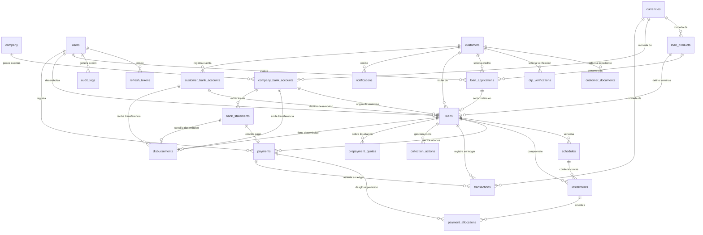
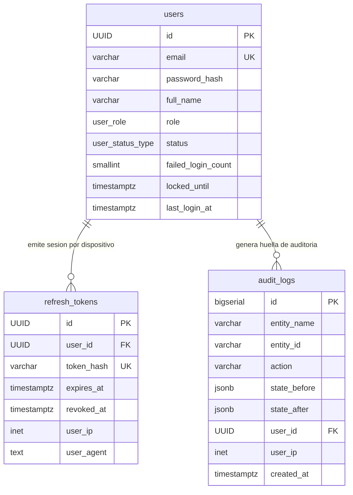
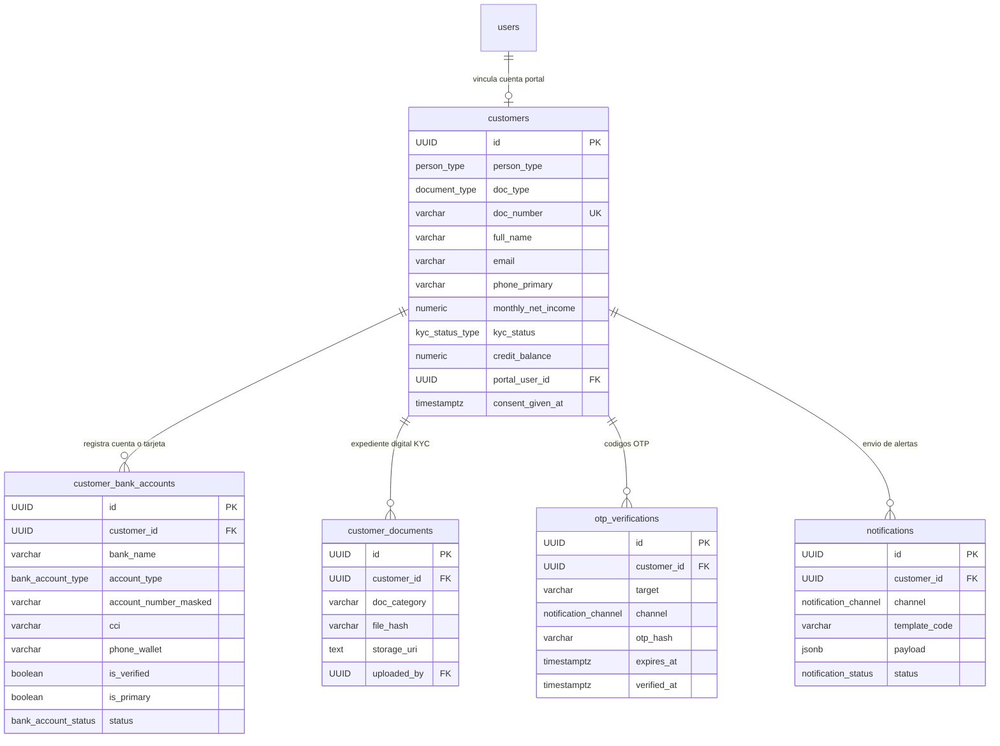
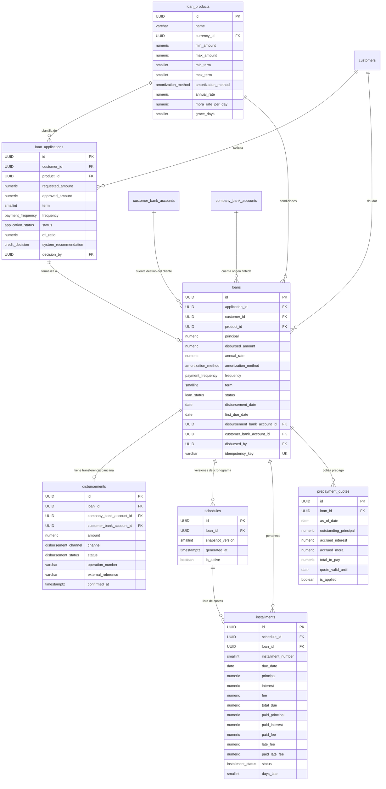
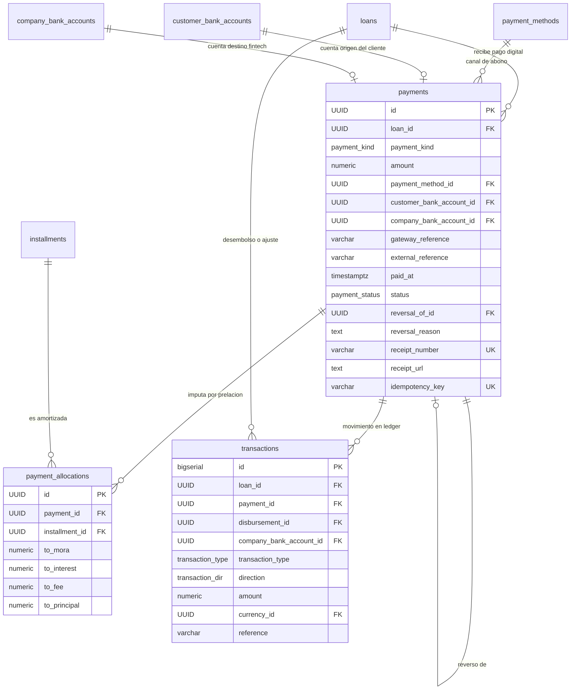
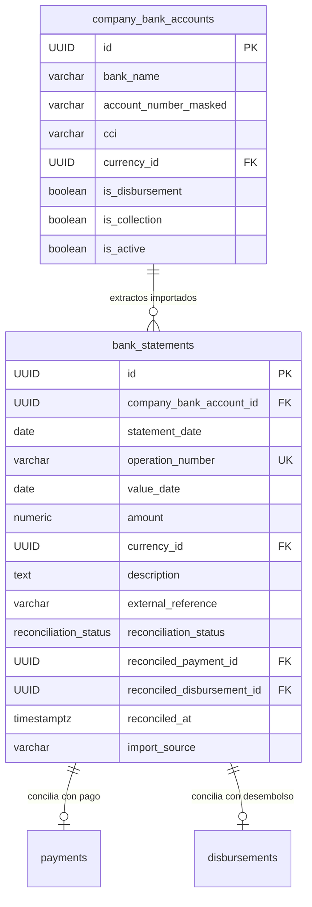
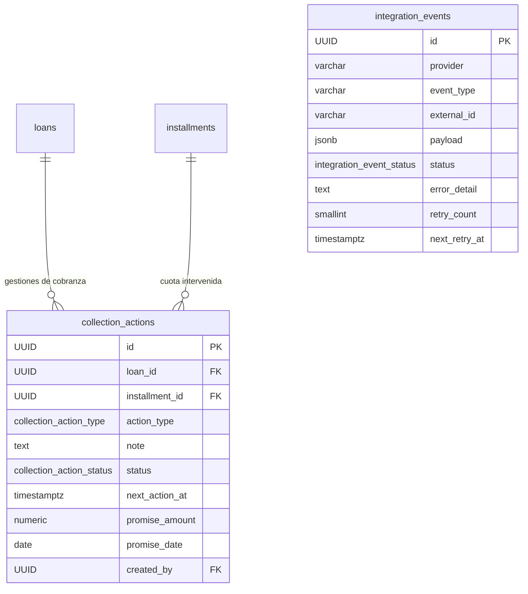

# Diagramas de Entidad - Relación (ERD)

> **Modelo:** Fintech 100% Digital — Sin sucursales físicas, sin cajas de efectivo, sin cobradores de campo.
> Todo el flujo de dinero ocurre por transferencias bancarias, Yape, Plin o pasarelas digitales.

Este documento detalla la topología de la base de datos a través de modelos conceptuales y físicos mediante diagramas Mermaid.

---

## 1. Diagrama General de la Arquitectura (Core del Sistema)

El siguiente diagrama presenta la interacción central entre los prestatarios, las cuentas bancarias digitales, los créditos formalizados, el cronograma de amortización, los abonos y la conciliación bancaria.

---

## 2. Subsistemas Detallados

### 2.1 Subsistema de Seguridad y Usuarios (Fintech Digital)
Gestiona las credenciales de acceso, la autenticación por JWT rotativo y el registro de bitácora inmutable.
Sin sucursales ni zonas geográficas: operación centralizada 100% digital.

---

### 2.2 Subsistema de Clientes, KYC y Cuentas Bancarias
Administra el perfil integral del prestatario, el expediente documental y las cuentas bancarias/tarjetas a las que se deposita el dinero.

---

### 2.3 Subsistema de Originación, Préstamos y Cronogramas (Core Financiero)
Gestiona el ciclo de vida de la solicitud, el desembolso digital con idempotencia y el cronograma congelado en snapshots.

---

### 2.4 Subsistema de Pagos Digitales, Cascada de Prelación y Libro Mayor
Gobernado por la jerarquía estricta de imputación: Mora → Intereses → Comisiones → Capital.
Sin efectivo: todos los pagos llegan por transferencia, Yape, Plin o pasarela de pago con confirmación por webhook.

---

### 2.5 Subsistema de Tesorería Digital y Conciliación Bancaria
Reemplaza las cajas físicas y el arqueo ciego por extractos bancarios digitales y conciliación automática por referencia/webhook.

---

### 2.6 Subsistema de Cobranza Digital e Integraciones
Motor de recuperación digital de cartera vencida: notificaciones, recordatorios y acuerdos de pago online.
Sin visitas domiciliarias ni cobradores de campo.

