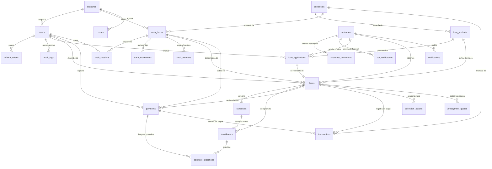
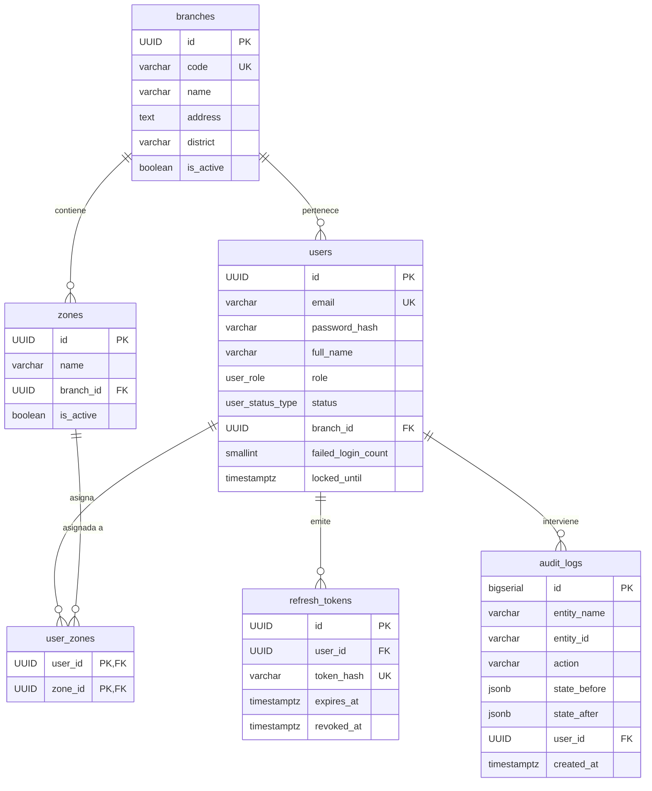
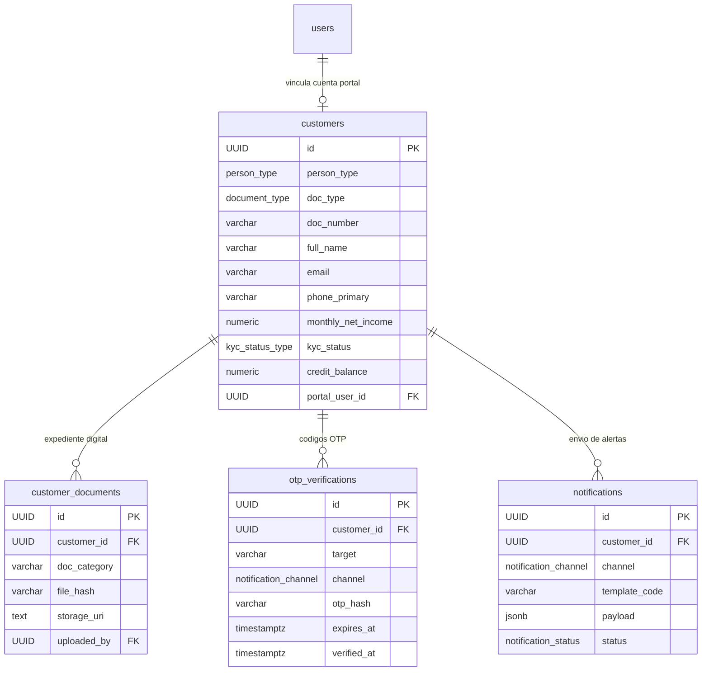
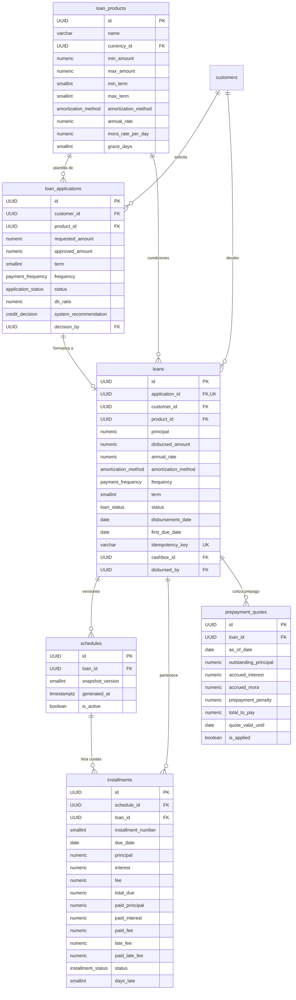
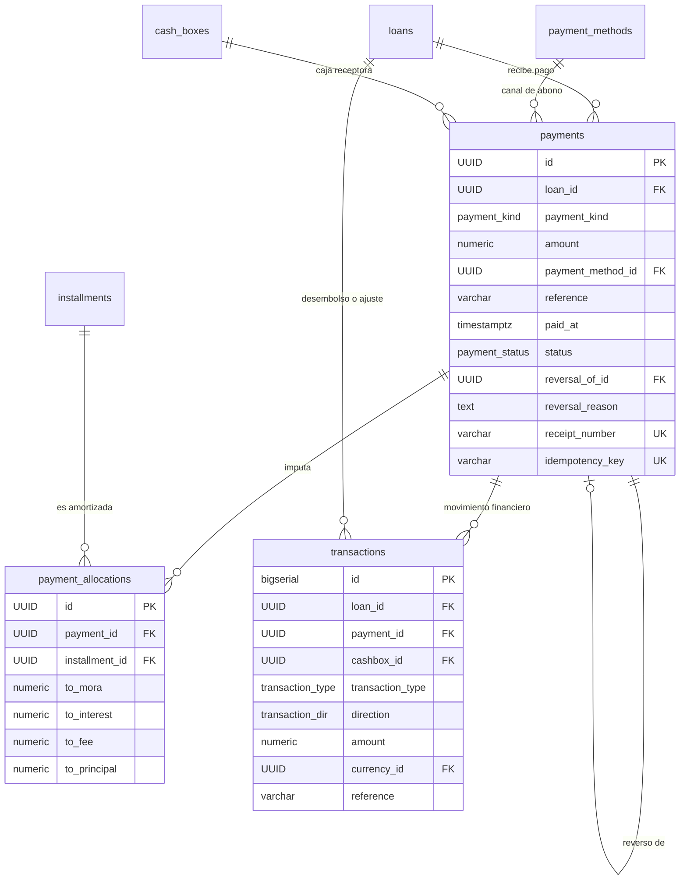
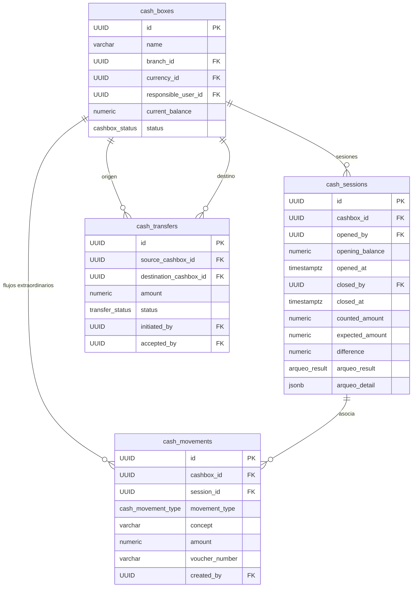
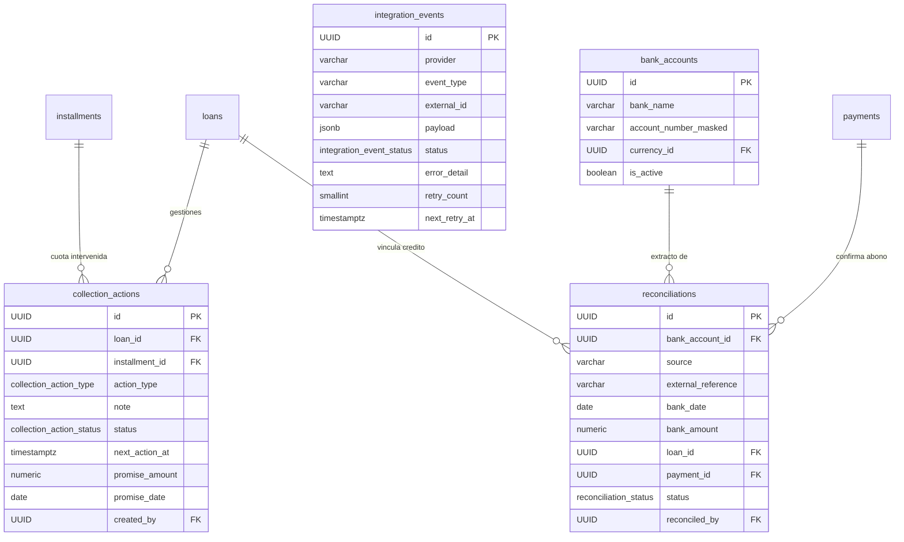

# Diagramas de Entidad - Relación (ERD)

Este documento detalla la topología de la base de datos a través de modelos conceptuales y físicos mediante diagramas Mermaid.

---

## 1. Diagrama General de la Arquitectura (Core del Sistema)

El siguiente diagrama presenta la interacción central entre los prestatarios, las solicitudes, los créditos formalizados, el cronograma de amortización, los abonos y la tesorería.

---

## 2. Subsistemas Detallados

### 2.1 Subsistema de Seguridad, Usuarios y Organización
Gestiona las credenciales de acceso, la autenticación por JWT rotativo y el registro de bitácora inmutable.

---

### 2.2 Subsistema de Clientes, Expedientes KYC y Portal
Administra el perfil integral del prestatario, el expediente documental y el portal de autoservicio.

---

### 2.3 Subsistema de Originación, Préstamos y Cronogramas (Core Financiero)
Gestiona el ciclo de vida de la solicitud, el desembolso con idempotencia y el cronograma congelado en snapshots.

---

### 2.4 Subsistema de Pagos, Cascada de Prelación y Libro Mayor
Gobernado por la jerarquía estricta de imputación: Mora -> Intereses -> Comisiones -> Capital.

---

### 2.5 Subsistema de Tesorería, Cajas y Arqueos
Supervisa la custodia física de efectivo, sesiones con arqueo ciego y transferencias seguras entre cajas.

---

### 2.6 Subsistema de Cobranzas, Integraciones y Conciliación
Motor de recuperación de cartera vencida y enlace seguro con el ecosistema bancario (webhooks y extractos).

